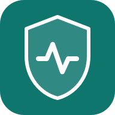
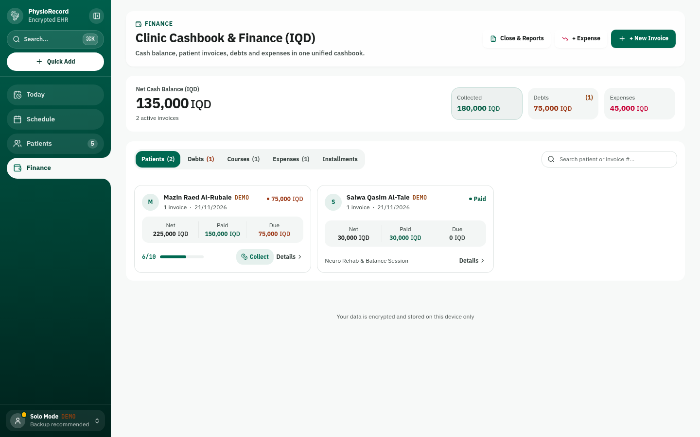
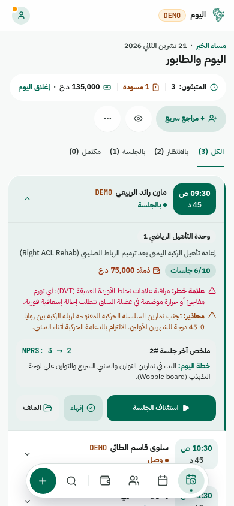
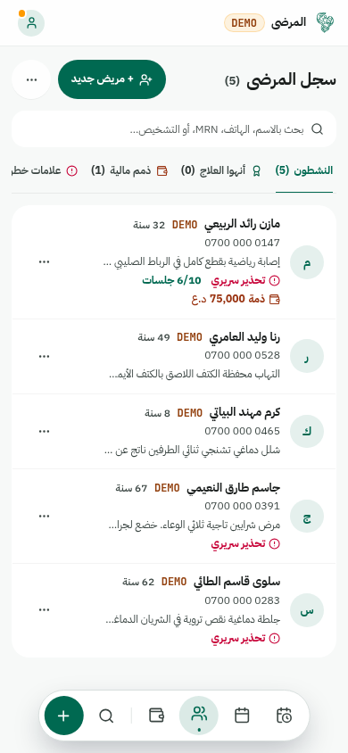

<div align="center">



# PhysioRecord

**Offline-First, Zero-Server, AES-256-GCM Encrypted Electronic Health Record (EHR) & Clinic Operations Platform for Physical Therapy**

[English](README.md) · [**العربية**](docs/README.ar.md) · [Documentation Portal](docs/INDEX.md)

<p>
  <a href="https://github.com/Hhi5/physiorecord/actions/workflows/ci.yml">
    
  </a>
  <a href="LICENSE">
    
  </a>
  
  
  
  
  
  
</p>

[Overview](#overview) · [Screenshots](#interface-preview) · [Features](#core-capabilities) · [Multi-Device Sync](#multi-device-sync-setup-optional--0) · [Security](#security--local-first-architecture) · [Quick Start](#quick-start) · [Builds](#multi-platform-builds) · [Docs](#documentation-portal)

</div>

---

## Overview

**PhysioRecord** is an open-source, **offline-first, zero-backend** physical therapy EHR and clinic management suite designed for solo clinicians and multi-therapist practices. Every patient chart, clinical assessment, appointment, and financial ledger entry stays encrypted at rest on the clinic's own device—running identically as an installable **Web PWA**, **Android Universal APK**, or **Windows Desktop (`.exe`)** application with native **Arabic (RTL)**, **Kurdish Sorani (`ckb` RTL)**, and **English (LTR)** interfaces. When a clinic needs multi-device sync, clinicians can opt in to **Local Clinic Wi-Fi (LAN)** or **End-to-End Encrypted Google Drive (`$0` BYOC)**—keeping full ownership of their data with zero subscriptions or vendor servers.

### Why PhysioRecord?

- **Local-First & Zero-Backend Sovereignty:** Works 100% offline out of the box with zero PhysioRecord backend servers, zero mandatory accounts, and zero telemetry (`Same-Origin` strict `CSP` enforced by automated offline E2E tests).
- **Optional `$0` Multi-Device Sync (User-Controlled & Non-Destructive):** Opt in only if needed via **Local Clinic Wi-Fi (LAN Hub)** over your regular clinic router, **End-to-End Encrypted Google Drive** (`drive.file` scope — encrypted locally with `AES-256-GCM` before upload so Google never sees plaintext PHI), or manual encrypted `.ptsync.json` files. Merging is strictly additive and never deletes local therapist records.
- **Opt-In In-App Release Notifications:** Disabled by default for strict zero-network privacy; when enabled in **Settings → Security**, checks official GitHub Releases (throttled to every 6 hours) and displays an in-app banner whenever a newer Android APK, Windows EXE, or Web release is published.
- **Power-Cut Resilient Drafting:** Encrypted `IndexedDB` draft buffers (`Dexie v10`) auto-save clinical notes, flowsheets, invoices, and appointments every 2 seconds and flush on page hide so sudden power outages never erase active charting.
- **Built for Real PT Clinical Flow:** Interactive front/back anatomical Body Charts, mobile-friendly bilateral `ROM`, free-text/smart `MMT`, Orthopedic Special Tests, full `ISNCSCI / ASIA` Neuro exam (10 key myotomes, 28 sensory levels, DTR & AIS), `MCID/MDC`-linked outcome calculators, immutable `SHA-256` finalized `SOAP` notes with append-only addenda, and audited deliberate deletion of mistaken finalized sessions.
- **Tailored for Iraqi Clinic Operations:** Native **Arabic (`ar` RTL)**, **Kurdish Sorani (`ckb` RTL)**, and **English (`en` LTR)** interfaces; solo and team RBAC modes; weekly recurring appointments with manual duration entry; Iraqi home-visit addresses; multi-currency `ISO 4217` invoicing defaulting to IQD (`25,000 د.ع`); local payment channels (`نقداً`, `ZainCash`, `QiCard`, `أخرى`); installment debt aging; and A4/A6 thermal/office printouts.

---

## Interface Preview

<table>
  <tr>
    <td align="center" width="50%">
      
      <br />
      <sub><b>Desktop — Today Command Center (Arabic RTL)</b></sub>
    </td>
    <td align="center" width="50%">
      
      <br />
      <sub><b>Desktop — Clinic Cashbook & Finance (English LTR)</b></sub>
    </td>
  </tr>
</table>

<details>
<summary><strong>View more screenshots (Dark Mode & Mobile RTL)</strong></summary>
<br />
<table>
  <tr>
    <td align="center" width="50%">
      
      <br />
      <sub><b>Desktop — Dark Mode (Arabic RTL)</b></sub>
    </td>
    <td align="center" width="25%">
      
      <br />
      <sub><b>Mobile — Today Queue</b></sub>
    </td>
    <td align="center" width="25%">
      
      <br />
      <sub><b>Mobile — Directory</b></sub>
    </td>
  </tr>
</table>
</details>

---

## Core Capabilities

### 1. Physical Therapy Clinical Documentation
- **Interactive Body Chart & Encrypted Attachments:** Front and back anatomical SVG views with pin markers, custom pain-type labels, per-pin color legends, localized clinical photo/PDF vault with side-by-side comparison, and photo goniometric angle/plumb-line studio (`Konva`).
- **Musculoskeletal & Neuro Assessments:** Bilateral Active/Passive/Assisted `ROM` (clean numeric inputs without distracting normative overlays), free-text or smart `MMT` (`0–5`), Orthopedic Special Tests across 9 joint regions, `ISNCSCI / ASIA` neurological exam (10 key myotomes with primary muscles, 28 sensory levels, DTR & AIS classification summary), regional Red Flags screening, and cardiopulmonary vitals (`BP`, `HR`, `SpO2`).
- **Outcome Measures & Goals:** Score-entry calculators (`ODI`, `NDI`, `QuickDASH`, `SPADI`, `LEFS`) with `MCID/MDC` deltas, open functional tests (`NPRS`, `PSFS`, `TUG`, `30s-CST`, `5xSTS`), Custom Measure Builder, Problem Lists, and `SMART / GAS` goals.
- **Immutable `SOAP` + Flowsheets:** Unified visit charting with `/` slash templates, 1-tap regional exam presets, exercise flowsheet progression helpers, `SHA-256` finalization seals, and append-only `clinicalAddenda`.

### 2. Clinic Operations & Iraqi Finance
- **Solo & Team Workflows:** Switch between fast Solo Mode (10-second walk-in registration & Today command view) and multi-therapist Team Mode (`Reception Command Center`, Staff Roster, `Admin PIN` RBAC, and privacy screen blur).
- **Scheduling & Home Visits:** Daily/weekly manual recurring schedules with editable session durations and non-blocking overbooking warnings, Iraqi home-visit addresses (Neighborhood / Mahalla / Zukak / Landmark + travel buffer & fee), branches, closed days, and waiting-room Patient Kiosk mode.
- **Billing, Installments & Retention:** Blank-default invoice creation (`فحص`, `جلسة مفردة`, `كورس`), Iraqi payment methods (`نقداً`, `ZainCash`, `QiCard`, `أخرى`), multi-installment plans, `30/60/90+` day debt aging, recurring clinic expenses, daily `Z-Reports`, referring physician progress letters, and patient retention queues.

### 3. Portability, Printing, Sync & Safe Updates
- **Print Portal (`A4` / `A6`) & Discharge Summary:** Single-page auto-fitted invoices, receipts, referring physician reports, treatment journey & discharge summaries (with dedicated Completed Treatment archive), full patient dossiers, visit/balance cards, HEP sheets, and signed informed consents.
- **Zero-Cost Multi-Therapist Sync (Optional, Strictly Non-Destructive):** Sync across clinic PC and therapists' phones via **Local Wi-Fi (LAN)** over the clinic's regular Wi-Fi router (no hotspot or internet needed) or **End-to-End Encrypted Google Drive (`$0`)** with offline outbox queueing and additive merging that never deletes therapist data.
- **In-App GitHub Release Update Alerts (Opt-In):** Keep Android, Windows, and Web installations current via optional GitHub Release notifications and safe in-place upgrades (`org.physiorecord.app`) that preserve the encrypted local vault.
- **Standards & Backups:** Encrypted `.ptbackup` `V3.0` archives (streaming `gzip` + `AES-GCM` chunks, backward compatible with `V1.1`/`V2.0`), `HL7 FHIR R4` JSON Bundles, `CSV`/`XLSX` patient onboarding with rollback, and privacy-filtered `.ics` calendar exports.

---

## Multi-Device Sync Setup (Optional, $0)

Sync is **disabled by default**—PhysioRecord makes zero external network connections unless you explicitly enable one of the two optional sync modes in **Settings → Data & Sync**:

| Sync Mode | Best For | Internet Needed? | Clinic PC Must Stay On? | Data Privacy |
| --- | --- | --- | --- | --- |
| **1. Local Wi-Fi (LAN Hub)** | Devices on the same clinic Wi-Fi router | **No (100% Offline)** | Only during the moment of sync (offline outbox queues edits when PC is off) | Strictly RFC1918 local Wi-Fi + 64-bit Pairing Token + `AES-256-GCM` envelopes |
| **2. Encrypted Google Drive (BYOC)** | Syncing when clinic PC is off, across branches, or from home | Only during sync (auto-queues offline) | **No** | Client-side `AES-256-GCM` + `PBKDF2` (`310,000` iters) before upload; minimal `drive.file` scope only |
| **3. Encrypted File (`.ptsync.json`)** | Air-gapped clinics, USB sticks, WhatsApp/AirDrop transfer | **No** | **No** | Client-side `AES-256-GCM` encrypted file with non-destructive merge |

### How to Set Up Local Wi-Fi (LAN) Sync
1. Connect the **Clinic Windows PC** and all **therapist phones/tablets** to the **same clinic Wi-Fi router** (no mobile hotspot is needed—just regular shared Wi-Fi).
2. On the Clinic Windows PC (Electron Desktop app), open **Settings → Data & Sync → Clinic Multi-Device Sync**, select **Local Wi-Fi (LAN)**, and click **Start Clinic Wi-Fi Sync Hub**.
3. Copy the displayed local address (e.g., `http://192.168.1.15:47821`) and **Pairing Token** into each therapist device, enter the same **Shared Clinic Sync Passphrase**, and click **Sync Now**.
4. If the clinic PC is turned off, therapists keep working normally—encrypted changes queue in the **Offline Outbox** and sync cleanly once the PC is turned back on.

### How to Set Up Encrypted Google Drive Sync (`$0` BYOC)
1. Open **Settings → Data & Sync → Clinic Multi-Device Sync** and select **Encrypted Google Drive**.
2. Click **Sign in with Google** and grant access strictly to the app's dedicated folder (`drive.file` scope — PhysioRecord **cannot** view or modify any other files in your Drive).
3. Enter the same **Shared Clinic Sync Passphrase** on every clinic device (stored in memory only—never uploaded to Google) and click **Sync Now**.
4. **Self-Hosting Note:** If you deploy your own copy of PhysioRecord on a custom domain, add that domain to Firebase Authentication **Authorized Domains** (and configure your Google Cloud OAuth consent screen) so the Google Sign-In popup completes without domain restrictions.

> **Non-Destructive Guarantee:** Both LAN and Google Drive sync use strictly **additive merging**—syncing never deletes existing records from a therapist's device, and finalized SOAP notes remain protected.

---

## Security & Local-First Architecture

```text
Clinician Password / WebAuthn PRF
   └─▶ PBKDF2-HMAC-SHA256 (>= 600,000 iterations in Web Worker)
         └─▶ Master Key (non-extractable WebCrypto)
               ├─▶ HKDF-SHA256 Per-Record Subkeys
               └─▶ AES-256-GCM Encrypted IndexedDB (PhysioRecordDB, Dexie v1–v10)
```

| Security Control | Implementation |
| --- | --- |
| **Encryption at Rest** | WebCrypto `AES-256-GCM` with atomic IV reservation & automatic 70% DEK rotation ([`src/crypto/vault.ts`](src/crypto/vault.ts)) |
| **Key Derivation & Unlock** | `PBKDF2-HMAC-SHA256` (`>= 600,000` iterations) inside a Web Worker + optional `WebAuthn PRF` passkey unlock |
| **Account Recovery & Lock** | Verified 32-character (`8×4` Base32) Emergency Recovery Key + configurable auto-lock (`Never` supported) |
| **Audit & Clinical Integrity** | `SHA-256` hash-chained clinic audit logs; finalized `SOAP` notes use append-only `clinicalAddenda` and require typed confirmation + audit trail for deliberate deletion |
| **Zero-Network Default & E2EE Sync** | Self-hosted `@fontsource/*` fonts, bundled assets, local service worker, strict `CSP` verified by Playwright offline tests; optional Google Drive / LAN sync encrypts all records client-side (`AES-256-GCM`) before leaving the device |
| **Desktop, Mobile & Parser Hardening** | Strict Electron `app://` path-boundary & IPC origin verification, RFC1918 LAN-only SSRF blocking, brute-force rate-limited LAN Hub, CSP-hardened HTML report exports, XLSX zip-bomb decompression limits, and prototype-pollution-safe JSON parsing |

> Cryptographic vault primitives honor the `GPL-3.0` attribution to [`Niema-Lab/PhysioMeter`](https://github.com/Niema-Lab/PhysioMeter) — see [`NOTICE`](NOTICE).

---

## Quick Start

### Prerequisites

- **Node.js `>= 20`** (CI runs Node `22`) and **`npm`**
- *(Optional, for Android APK builds)* **Java 21 JDK (`keytool`)** + **Android SDK**

### Run Locally

```bash
# 1. Clone the repository
git clone https://github.com/Hhi5/physiorecord.git
cd physiorecord

# 2. Install dependencies
npm ci

# 3. Start the local development server on http://localhost:3000
npm run dev
```

### Public Demo Mode

Launch the app with `?demo=1` (e.g., `http://localhost:3000/?demo=1`) or build with `VITE_PUBLIC_DEMO=true` to reveal the demo banner for one-click seeding and purging of `CC0-1.0` fictional physical therapy cases (`src/data/syntheticPatients.ts`) — dynamically localized in **Arabic**, **Kurdish Sorani (`ckb`)**, and **English** whenever you switch interface language.

---

## Multi-Platform Builds

PhysioRecord uses locked persistent app identifier `org.physiorecord.app` across all targets:

```bash
# 1. Web PWA production bundle (emits /sw.js & /manifest.webmanifest)
npm run build:web

# 2. Android Universal APK (Capacitor 8)
npm run android:keystore:init   # One-time local release keystore generation (.keystore/)
npm run android:sync            # Builds android bundle + syncs android/ Gradle project

# 3. Windows Desktop (Electron 34 + electron-builder)
npm install --no-save electron@34.3.0 electron-builder@25.1.8
npm run electron:start          # Launch desktop shell locally
npm run electron:dist           # Build NSIS Setup + Portable .exe into release/

# 4. Sync single-source version across package.json, in-app metadata & Android versionCode
node scripts/sync-version.mjs --version=v1.1.0
```

See [`docs/DESKTOP_ANDROID_RELEASE.md`](docs/DESKTOP_ANDROID_RELEASE.md) and [`docs/UPDATES_AND_SIGNING.md`](docs/UPDATES_AND_SIGNING.md) for signing secrets and in-place data-survival upgrade testing.

---

## Tech Stack & Repository Structure

| Layer | Technologies |
| --- | --- |
| **UI & Accessibility** | React `19`, TypeScript `7`, Tailwind CSS v4 (`@tailwindcss/vite`), React Aria Components (`Apache-2.0`), Lucide Icons (`ISC`) |
| **Self-Hosted Typography** | `@fontsource/ibm-plex-sans-arabic`, `@fontsource/inter`, `@fontsource/jetbrains-mono` (`OFL-1.1`) |
| **Storage & Search** | Dexie `4` (`IndexedDB` `v1`–`v10`, 28 stores), `MiniSearch` `7` (Arabic/Kurdish normalization), `Zod` `4` |
| **Clinical Canvas** | `Konva` + `react-konva` (photo angle/posture measurement & annotations) |
| **Desktop & Mobile Shells** | Capacitor `8` (`@capacitor/android`), Electron `34` + `electron-builder` (`25.1.8`) |
| **Build & QA Tooling** | Vite `8`, Vitest `5`, Playwright `1.65` + `@axe-core/playwright` |

<details>
<summary><strong>Explore repository directory layout</strong></summary>

```text
physiorecord/
├── .github/                  # CI/Release workflows, Dependabot, Templates, SECURITY & CONTRIBUTING
├── android/                  # Capacitor Android project (Universal APK, org.physiorecord.app)
├── docs/                     # Documentation portal, Arabic README (README.ar.md) & legal/ notices
├── e2e/                      # Playwright E2E tests, zero-network checks & playwright.config.ts
├── electron/                 # Electron Windows Desktop shell & electron-builder.yml
├── public/                   # Static icons & deployment security headers (_headers)
├── scripts/                  # Build target, PWA plugin, license/content/perf gates, keystore & SBOM
├── src/
│   ├── components/
│   │   ├── clinic/           # Today, Reception, Schedule, Finance Ledger, HEP, Modals & Panels
│   │   ├── layout/           # AppLayout & navigation shell
│   │   ├── organui/          # Clinical progression SVG charts & medication schedule UI
│   │   ├── print/            # A4/A6 @media print portal (Invoices, Reports, Dossiers, HEP)
│   │   ├── settings/         # Modular Settings tabs & Display/Font preferences
│   │   ├── toolkit/          # ASIA/ISNCSCI sensory table reference
│   │   ├── ui/               # Project-owned accessible primitives (React Aria, Modals, Tabs)
│   │   ├── widgets/          # BodyChart, ROM, MMT, Neuro, SpecialTests, FunctionalScales, Gait
│   │   └── workspace/        # MasterPatientChart (chart/) & TreatmentSessionView (session/)
│   ├── context/              # Vault, Language (ar/ckb/en), Theme, Currency, Patient/Episode/Session
│   ├── crypto/               # WebCrypto AES-GCM vault, PBKDF2 Worker, .ptbackup, WebAuthn PRF
│   ├── data/                 # Consent templates, CC0 note snippets, terminology & clinicalToolkit/
│   ├── db/                   # Dexie v1–v10 schema (28 stores), registry & durability helpers
│   ├── hooks/                # Reusable hooks (useVirtualWindow)
│   ├── i18n/                 # Externalized ar/ckb/en dictionaries & Kurdish Sorani phrase mapper
│   ├── platform/             # Unified Web / Capacitor Android / Electron native bridge
│   ├── pwa/                  # Offline Service Worker registration & update client
│   ├── services/             # Single-writer domain facade (operations/, session, soap, episode)
│   ├── styles/themes/        # Semantic Tailwind v4 clinical palettes
│   ├── types/                # Clinical, toolkit, widget & clinic management TypeScript types
│   └── utils/                # MCID/MDC, FHIR R4 export, CSV/XLSX import, Iraqi finance/schedule
├── AGENTS.md                 # Architectural invariants, license rules & preserved customizations
├── CHANGELOG.md              # Release history & phase summary
├── LICENSE                   # GPL-3.0-or-later license
└── NOTICE                    # Upstream & third-party attribution notice
```

</details>

---

## Verification & Compliance

Every pull request runs automated security, licensing, asset-manifest, performance-budget, and offline E2E checks:

```bash
npm run check:licenses                    # Verify SPDX licenses for all runtime & dev packages
npm run check:content                     # Verify SVGs, fonts & catalogs in docs/legal/CONTENT_LICENSES.md
npm run lint                              # TypeScript static typecheck (tsc --noEmit)
npm test                                  # Vitest unit, crypto, Dexie migration & domain tests
npm run build                             # Vite production bundle + strict CSP & PWA manifest
npm run check:perf                        # Verify bundle sizes against docs/PERFORMANCE_BUDGET.json
npm run sbom                              # Generate CycloneDX SBOM (build/sbom.cdx.json)
npm run test:e2e                          # Playwright E2E, zero-network, axe-core & RTL checks
npm audit --omit=dev --audit-level=high   # Production dependency vulnerability audit
```

---

## Documentation Portal

| Guide | Focus |
| --- | --- |
| **[`docs/INDEX.md`](docs/INDEX.md)** | Full bilingual Arabic/English documentation hub |
| **[`CHANGELOG.md`](CHANGELOG.md)** | Release history (`v1.0.0` & `v1.1.0` Phases `A`–`F`) |
| **[`docs/ARCHITECTURE.md`](docs/ARCHITECTURE.md)** | Local-first topology, single-writer services & 28 Dexie stores |
| **[`docs/THREAT_MODEL.md`](docs/THREAT_MODEL.md)** | Cryptographic design & security threat boundaries |
| **[`docs/MIGRATIONS.md`](docs/MIGRATIONS.md)** | Append-only Dexie `v1`–`v10` schema migrations |
| **[`docs/BACKUP_FORMAT.md`](docs/BACKUP_FORMAT.md)** | `.ptbackup` `V3.0` chunked encrypted archive specification |
| **[`docs/FHIR_R4_MAPPING.md`](docs/FHIR_R4_MAPPING.md)** | HL7 FHIR R4 Bundle (`LOINC` / `SNOMED CT`) mapping |
| **[`docs/TRANSLATION_GUIDE.md`](docs/TRANSLATION_GUIDE.md)** | `ar` / `ckb` / `en` localization & RTL guidelines |
| **[`docs/UI_DESIGN_SYSTEM_V2.md`](docs/UI_DESIGN_SYSTEM_V2.md)** | Design tokens & `pr-*` component reference |

---

## Clinical Disclaimer & License

> **Clinical & Non-Medical-Device Notice:** **PhysioRecord** is a local clinic record-keeping and organizational software tool—not a certified medical device. Bundled clinical catalogs marked *"Pending Clinician Review"* require independent clinician verification prior to clinical use. See [`docs/legal/DISCLAIMER.md`](docs/legal/DISCLAIMER.md), [`docs/legal/PRIVACY.md`](docs/legal/PRIVACY.md), and [`.github/SECURITY.md`](.github/SECURITY.md).

- **Contributing:** Read [`AGENTS.md`](AGENTS.md), [`.github/CONTRIBUTING.md`](.github/CONTRIBUTING.md), and [`.github/CODE_OF_CONDUCT.md`](.github/CODE_OF_CONDUCT.md) before modifying Dexie schemas, cryptography, Iraqi defaults, or third-party dependencies.
- **License:** Distributed under the **`GPL-3.0-or-later`** license — see [`LICENSE`](LICENSE), [`NOTICE`](NOTICE), [`docs/legal/CONTENT_LICENSES.md`](docs/legal/CONTENT_LICENSES.md), and [`docs/legal/THIRD_PARTY_NOTICES.md`](docs/legal/THIRD_PARTY_NOTICES.md).
