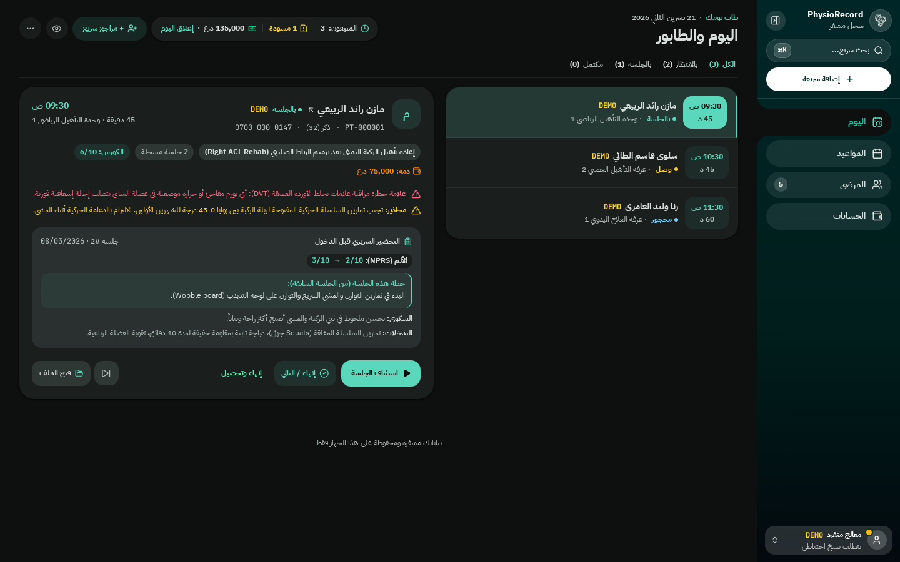
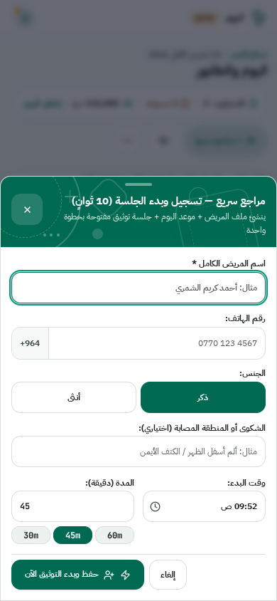

<div align="center">


# PhysioRecord

**Offline-First, Zero-Server, AES-256-GCM Encrypted Electronic Health Record (EHR) & Clinic Operations Suite for Physical Therapy**

[English](README.md) · [**العربية**](docs/README.ar.md) · [Documentation Portal](docs/INDEX.md) · [Latest Release](https://github.com/Hhi5/physiorecord/releases/latest)

<p>
  <a href="https://github.com/Hhi5/physiorecord/actions/workflows/ci.yml">
    
  </a>
  <a href="LICENSE">
    
  </a>
  
  
  
  
  
  
</p>

[Overview](#overview) · [Install & Platforms](#install--supported-platforms) · [Screenshots](#interface-preview) · [Features](#complete-feature-walkthrough) · [Multi-Device Sync](#multi-device-sync-optional-0) · [Security](#security--trust-architecture) · [Developer Guide](#developer-quick-start) · [Docs](#documentation-portal)

</div>

---

## Overview

**PhysioRecord** is an open-source, **offline-first, zero-backend** Electronic Health Record (EHR) and clinic management platform built specifically for **solo physical therapists and multi-therapist rehabilitation clinics**.

Every patient chart, assessment, clinical photo, appointment, and financial invoice lives **encrypted at rest on your own device** (`IndexedDB` + WebCrypto `AES-256-GCM`)—with **zero mandatory accounts, zero subscriptions, zero vendor servers, and zero telemetry**. It runs natively in **Arabic (`ar` RTL)**, **Kurdish Sorani (`ckb` RTL)**, and **English (`en` LTR)**, and offers optional `$0` multi-device sync over your **clinic's local Wi-Fi** or **end-to-end encrypted Google Drive**.

### At a Glance

| Pillar | What You Get |
| --- | --- |
| **100% Local-First Sovereignty** | Works completely offline out of the box. Zero PhysioRecord servers, zero tracking, strict `Same-Origin` CSP verified by automated offline Playwright E2E tests. |
| **End-to-End Encrypted Vault** | WebCrypto `AES-256-GCM` with `PBKDF2-HMAC-SHA256` (`>= 600,000` iterations in a Web Worker), `HKDF-SHA256` per-record subkeys, 32-char Recovery Key, and biometric/OS unlock. |
| **Power-Cut Resilient Charting** | Encrypted `IndexedDB` draft buffers auto-save SOAP notes, flowsheets, invoices, and appointments every 2 seconds and flush on page hide. |
| **Built for Physical Therapy** | Front/back Body Chart, bilateral `ROM`, `MMT`, 9-region Special Tests, `ISNCSCI / ASIA` Neuro, `MCID/MDC` Outcome Calculators, `Konva` posture/angle studio, and immutable `SHA-256` SOAP notes. |
| **Iraqi Clinic Ready (AR / CKB / EN)** | Solo & Team RBAC modes, recurring appointments, Iraqi home-visit addresses, `ISO 4217` invoicing defaulting to IQD (`25,000 د.ع`), local payments (`نقداً`, `ZainCash`, `QiCard`, `أخرى`), installments, and `A4`/`A6` printouts. |
| **Optional `$0` Multi-Device Sync** | Disabled by default. Opt in to **Local Clinic Wi-Fi (LAN Hub)**, **E2EE Google Drive (`drive.file`)**, or offline **`.ptsync.json`** files—strictly additive and non-destructive. |

---

## Install & Supported Platforms

PhysioRecord uses one locked persistent identity (`org.physiorecord.app`) so upgrading never erases your encrypted clinical vault.

| Platform | Recommended Installation | Data Persistence & Updates |
| --- | --- | --- |
| **Windows 10 / 11 (x64)** | Download **`PhysioRecord-Setup-*.exe`** (or Portable `.exe`) from [GitHub Releases](https://github.com/Hhi5/physiorecord/releases/latest). | Native Electron desktop app (`app://bundle`). Installing a newer Setup upgrades in place while preserving `%APPDATA%\PhysioRecord`. |
| **Android (Phone & Tablet)** | Download the signed Universal **`PhysioRecord-*.apk`** from [GitHub Releases](https://github.com/Hhi5/physiorecord/releases/latest). | Native Capacitor Android shell (`org.physiorecord.app`). Supports in-place APK upgrades and Android biometric unlock. |
| **iPhone & iPad (iOS / iPadOS)** | Open the hosted web link in **Safari** → tap **Share** → **Add to Home Screen**. | Runs as a standalone offline PWA from your Home Screen with local encrypted `IndexedDB` storage—no App Store fees. |
| **macOS** | Open in **Safari** → **File → Add to Dock** (or Chrome/Edge → **Install App**). | Runs as a standalone installed Dock app with persistent local encrypted storage. |

> **Built-In Platform Access Gate:** On production web deployments, visitors on Android or Windows browsers are automatically guided to the dedicated native installer, while iOS/macOS browser tabs are guided to install via Safari Home Screen / Dock—protecting clinic data from accidental browser-tab eviction.

---

## Interface Preview

<table>
  <tr>
    <td align="center" width="50%">
      
      <br />
      <sub><b>Desktop — Today Command Center (Arabic RTL)</b></sub>
    </td>
    <td align="center" width="50%">
      
      <br />
      <sub><b>Desktop — Clinic Cashbook & Finance (English LTR)</b></sub>
    </td>
  </tr>
</table>

<details>
<summary><strong>View more screenshots (Patient Chart, Dark Mode &amp; Mobile RTL)</strong></summary>
<br />
<table>
  <tr>
    <td align="center" width="50%">
      
      <br />
      <sub><b>Desktop — Master Patient Chart (Arabic RTL)</b></sub>
    </td>
    <td align="center" width="50%">
      
      <br />
      <sub><b>Desktop — Dark Mode (Arabic RTL)</b></sub>
    </td>
  </tr>
</table>
<table>
  <tr>
    <td align="center" width="33%">
      
      <br />
      <sub><b>Mobile — Today Queue</b></sub>
    </td>
    <td align="center" width="33%">
      
      <br />
      <sub><b>Mobile — Patient Directory</b></sub>
    </td>
    <td align="center" width="33%">
      
      <br />
      <sub><b>Mobile — Quick Walk-In Sheet</b></sub>
    </td>
  </tr>
</table>
</details>

---

## Complete Feature Walkthrough

### 1. Physical Therapy Clinical Documentation
- **Patient Chart & Episode Management:** Unified Master Patient Chart with Arabic/Kurdish/English normalized fuzzy search (`MiniSearch`), duplicate-patient detection & transactional merge, structured precautions/contraindications, imaging report tracking, and episode-of-care timelines.
- **Interactive Anatomical Body Chart:** Front and back clinical body views with pin markers, custom pain-quality labels, and per-pin color legends.
- **Musculoskeletal & Neurological Exam Battery:**
  - **ROM (Goniometry):** Clean bilateral Active / Passive / Assisted (`AROM` / `PROM` / `AAROM`) numeric fields without distracting normative overlays.
  - **MMT (Strength):** Free-text or quick-assist muscle strength cards (`0–5`) starting clean with `+` to add tests on demand.
  - **Orthopedic Special Tests:** Concise provocative tests and target anatomical structures across all 9 joint regions.
  - **ISNCSCI / ASIA Neurological Exam:** Complete 10 key myotomes, 28 sensory dermatomes, deep tendon reflexes (`DTR`), and automated `AIS` classification summary.
  - **Screening & Vitals:** Regional Red Flags checklist and cardiopulmonary vitals (`BP`, `HR`, `SpO2`) with configurable alert thresholds.
- **Outcome Measures, Goals & Progress Tracking:**
  - Built-in score calculators (`ODI`, `NDI`, `QuickDASH`, `SPADI`, `LEFS`) with `MCID / MDC` progress tracking, open functional tests (`NPRS`, `PSFS`, `TUG`, `30s-CST`, `5xSTS`), and a **Custom Measure & Custom Widget Builder**.
  - Problem Lists, `SMART / GAS` rehabilitation goals, longitudinal trajectory sparklines, and Completed Treatment discharge archives.
- **Immutable SOAP Notes & Flowsheets:** Unified visit paper with `/` slash templates, 1-tap regional exam presets, exercise/manual therapy/physical agent flowsheets, `SHA-256` finalization seals, append-only `clinicalAddenda`, and audited confirmation for deliberate deletion of mistaken finalized sessions.
- **Encrypted Clinical Media & Measurement Studio:** Local encrypted photo & PDF vault with side-by-side comparison and a `Konva` goniometric angle, Cobb angle, distance, and plumb-line annotation studio.

### 2. Clinic Operations, Scheduling & Iraqi Practice Workflows
- **Solo Mode & Team Mode (RBAC):** Switch between fast Solo Mode (10-second walk-in registration & Today Command Center) and multi-therapist Team Mode (Reception Command Center, Staff Roster, `Admin PIN` role switching, and 1-click privacy blur).
- **Appointments & Home Visits:** Daily/weekly recurring weekday schedules with interactive clock selector, manual session duration entry, non-blocking overbooking warnings, multi-branch locations, closed days/breaks, and **Iraqi home-visit addresses** (Neighborhood / Mahalla / Zukak / Landmark + travel buffer & fee).
- **Waiting-Room Patient Kiosk & HEP:** Optional waiting-room intake kiosk mode and built-in Home Exercise Program (HEP) library (toggleable in Settings).
- **Referring Doctors & Retention Hub:** Referring physician directory, referral source revenue analytics, customizable printable A4 **Report-Back Letters**, and 4 actionable retention queues with one-tap WhatsApp reminder links.

### 3. Iraqi Financial Ledger & Billing
- **Blank-Default Invoicing:** Invoice forms start clean/blank (never prefilled prices), supporting `فحص` (Assessment), `جلسة مفردة` (Single Session), and `كورس` (Course/Package).
- **Multi-Currency & Local Payments:** Global `ISO 4217` currency selector defaulting to Iraqi Dinar (`25,000 د.ع` with symbol after the number) and native payment methods (`نقداً`, `ZainCash`, `QiCard`, and custom `أخرى`).
- **Debt, Expenses & Closing:** Multi-installment payment plans, `30/60/90+` day debt aging reports, recurring clinic expenses, and daily cashbook `Z-Reports`.

### 4. Printing, Backups & Clinical Interoperability
- **Print & PDF Portal (`A4` / `A6`):** Single-page auto-fitted invoices, receipts, referring physician reports, treatment journey & discharge summaries, full patient dossiers, visit/balance cards, HEP sheets, and signed informed consents (with direct native PDF export on Desktop).
- **Encrypted Backups & Recovery Drills:** Streaming `.ptbackup` `V3.0` archives (`gzip` + chunked `AES-GCM`, backward compatible with `V1.1`/`V2.0`), automatic desktop backup folder support, and isolated sandbox backup verification drills.
- **Standards & Data Quality:** `HL7 FHIR R4` JSON Bundle export, `CSV`/`XLSX` patient onboarding wizard with dry-run preview & rollback, privacy-filtered `.ics` calendar export, 30-day non-clinical Recycle Bin, and Data Health orphan scanner.

---

## Multi-Device Sync (Optional, $0)

Sync is **disabled by default**—PhysioRecord makes zero external network calls unless you explicitly enable a sync mode in **Settings → Data & Sync**:

| Sync Mode | Best For | Internet Needed? | Clinic PC Must Stay On? | Data Privacy |
| --- | --- | --- | --- | --- |
| **1. Local Wi-Fi (LAN Hub)** | Devices on the same clinic Wi-Fi router | **No (100% Offline)** | Only at the moment of sync (offline outbox queues edits when PC is off) | Strictly RFC1918 private LAN + 64-bit Pairing Token + `AES-256-GCM` envelopes |
| **2. Encrypted Google Drive (BYOC)** | Syncing when clinic PC is off, across branches, or from home | Only during sync (auto-queues offline) | **No** | Client-side `AES-256-GCM` + `PBKDF2` (`310,000` iters) before upload; minimal `drive.file` scope only |
| **3. Encrypted File (`.ptsync.json`)** | Air-gapped clinics, USB drives, or manual transfer | **No** | **No** | Client-side `AES-256-GCM` encrypted file with non-destructive merge |

> **Non-Destructive Guarantee:** All sync modes perform strictly **additive merging**—syncing never deletes existing clinical records from a therapist's device, and finalized SOAP notes remain protected.

<details>
<summary><strong>Step-by-step setup for Local Wi-Fi (LAN) &amp; Encrypted Google Drive</strong></summary>

#### Local Wi-Fi (LAN) Sync
1. Connect the **Clinic Windows PC** and all **therapist phones/tablets** to the **same clinic Wi-Fi router** (no hotspot or internet needed).
2. On the Clinic Windows PC (Desktop app), open **Settings → Data & Sync → Clinic Multi-Device Sync**, select **Local Wi-Fi (LAN)**, and click **Start Clinic Wi-Fi Sync Hub**.
3. Enter the displayed local URL (e.g., `http://192.168.1.15:47821`), **Pairing Token**, and your **Shared Clinic Sync Passphrase** on each therapist device, then tap **Sync Now**.

#### Encrypted Google Drive Sync (`$0` BYOC)
1. Open **Settings → Data & Sync → Clinic Multi-Device Sync** and select **Encrypted Google Drive**.
2. Sign in with Google and grant access strictly to the app's own folder (`drive.file` scope — PhysioRecord cannot view or touch any other Drive files).
3. Enter the same **Shared Clinic Sync Passphrase** on each device (kept in memory only, never uploaded) and tap **Sync Now**.

</details>

---

## Security & Trust Architecture

```text
Clinician Password / WebAuthn PRF / Windows Hello / Touch ID
   └─▶ PBKDF2-HMAC-SHA256 (>= 600,000 iterations in dedicated Web Worker)
         └─▶ Master Key (non-extractable WebCrypto)
               ├─▶ HKDF-SHA256 Per-Record Subkeys
               └─▶ AES-256-GCM Encrypted IndexedDB (PhysioRecordDB, Dexie v1–v10)
```

| Security Control | Implementation |
| --- | --- |
| **Encryption at Rest** | WebCrypto `AES-256-GCM` with atomic IV reservation & automatic 70% DEK rotation ([`src/crypto/vault.ts`](src/crypto/vault.ts)) |
| **Key Derivation & Unlock** | `PBKDF2-HMAC-SHA256` (`>= 600,000` iterations) inside a Web Worker + optional `WebAuthn PRF`, Android Biometrics, Windows Hello (`DPAPI`), and macOS Touch ID (`Keychain`) |
| **Recovery & Auto-Lock** | Verified 32-character (`8×4` Base32) Emergency Recovery Key + configurable inactivity auto-lock (`Never` supported) |
| **Clinical Integrity & Audit** | `SHA-256` hash-chained clinic audit logs; finalized `SOAP` records are sealed and corrected via append-only `clinicalAddenda` |
| **Zero-Network Default** | Self-hosted `@fontsource/*` fonts, local SVGs & Service Worker, strict `CSP` verified by Playwright offline tests; opt-in update alerts disabled by default |
| **Desktop & Parser Hardening** | Electron `app://bundle` path-boundary & IPC origin verification, `connect-src 'none'` renderer CSP, RFC1918-only LAN SSRF guard, brute-force rate-limited LAN Hub (`429`), sanitized HTML exports, XLSX zip-bomb limits, and prototype-pollution-safe JSON parsing |

> Cryptographic vault primitives honor the `GPL-3.0` attribution to [`Niema-Lab/PhysioMeter`](https://github.com/Niema-Lab/PhysioMeter) — see [`NOTICE`](NOTICE).

---

## Developer Quick Start

### Prerequisites

- **Node.js `>= 20`** (CI runs Node `22`) and **`npm`**
- *(Optional, for Android APK builds)* **Java 21 JDK (`keytool`)** + **Android SDK**

### Install & Run Locally

```bash
# 1. Clone the repository
git clone https://github.com/Hhi5/physiorecord.git
cd physiorecord

# 2. Install dependencies
npm ci

# 3. (Optional) Copy environment template for local overrides
cp .env.example .env.local

# 4. Start the development server at http://localhost:3000
npm run dev
```

### Public Demo Mode

Open `http://localhost:3000/?demo=1` (or build with `VITE_PUBLIC_DEMO=true`) to show the demo banner for one-click seeding and purging of `CC0-1.0` fictional physical therapy cases (`src/data/syntheticPatients.ts`) dynamically localized in **Arabic**, **Kurdish Sorani (`ckb`)**, and **English**.

### Multi-Platform Production Builds

```bash
# 1. Web PWA production bundle (emits /sw.js & /manifest.webmanifest)
npm run build:web

# 2. Android Universal APK (Capacitor 8)
npm run android:keystore:init   # One-time local release keystore generation (.keystore/)
npm run android:sync            # Builds android bundle + syncs android/ Gradle project

# 3. Windows Desktop (Electron 34 + electron-builder)
npm install --no-save electron@34.3.0 electron-builder@25.1.8
npm run electron:start          # Launch desktop shell locally
npm run electron:dist           # Build NSIS Setup + Portable .exe into release/

# 4. Sync version across package.json, in-app metadata & Android versionCode
node scripts/sync-version.mjs --version=v1.1.0
```

See [`docs/DESKTOP_ANDROID_RELEASE.md`](docs/DESKTOP_ANDROID_RELEASE.md) and [`docs/UPDATES_AND_SIGNING.md`](docs/UPDATES_AND_SIGNING.md) for signing secrets and data-survival upgrade testing.

---

## Tech Stack, Folder Structure & Architecture

| Layer | Technologies |
| --- | --- |
| **UI & Accessibility** | React `19`, TypeScript `7`, Tailwind CSS `4` (`@tailwindcss/vite`), React Aria Components (`Apache-2.0`), Lucide Icons (`ISC`) |
| **Self-Hosted Typography** | `@fontsource/ibm-plex-sans-arabic`, `@fontsource/inter`, `@fontsource/jetbrains-mono` (`OFL-1.1`) |
| **Storage & Search** | Dexie `4` (`IndexedDB` `v1`–`v10`, 28 stores), `MiniSearch` `7` (Arabic/Kurdish normalization), `Zod` `4` |
| **Clinical Canvas** | `Konva` `10` + `react-konva` `19` (photo angle/posture measurement & annotations) |
| **Desktop & Mobile Shells** | Capacitor `8` (`@capacitor/android`), Electron `34` + `electron-builder` (`25.1.8`) |
| **Build & QA Tooling** | Vite `8`, Vitest `5`, Playwright `1.65` + `@axe-core/playwright` |

<details open>
<summary><strong>Explore repository directory layout</strong></summary>

```text
physiorecord/
├── .github/                  # CI/Release workflows, Dependabot, Templates, SECURITY & CONTRIBUTING
├── android/                  # Capacitor Android project (Universal APK, org.physiorecord.app)
├── docs/                     # Documentation portal, Arabic README (README.ar.md) & legal/ notices
├── e2e/                      # Playwright E2E tests, zero-network checks & playwright.config.ts
├── electron/                 # Hardened Electron desktop shell (modular main process)
│   ├── main.mjs              # App lifecycle, app://bundle protocol, window & core file/print IPC
│   ├── preload.cjs           # Context-isolated renderer bridge (window.physioDesktop)
│   ├── security.mjs          # CSP, MIME map, URL/LAN allowlists, safe JSON & atomic config I/O
│   ├── lanSyncServer.mjs     # Built-in local clinic Wi-Fi E2EE sync hub & client exchange
│   ├── googleOAuth.mjs       # Desktop PKCE loopback OAuth, Drive API proxy & sync folder exchange
│   ├── osBiometrics.mjs      # Windows Hello / macOS Touch ID + safeStorage vault key wrapping
│   ├── githubReleases.mjs    # Opt-in main-process GitHub Releases update checker
│   └── electron-builder.yml  # Windows NSIS Setup + Portable packaging configuration
├── public/                   # Static icons & deployment security headers (_headers)
├── scripts/                  # Build target, PWA plugin, license/content/perf gates, keystore & SBOM
├── src/
│   ├── components/
│   │   ├── auth/             # LockScreen, PrivacyCoverOverlay, PasswordReminder & PlatformAccessGate
│   │   ├── clinic/           # Today, Reception, Schedule (schedule/), Finance, Referrals (referrals/), HEP
│   │   ├── layout/           # AppLayout, Sidebar, MobileFloatingDock, CommandPalette & AccountMenu
│   │   ├── organui/          # Clinical progression SVG charts & medication schedule UI
│   │   ├── patients/         # PatientDirectory, PatientModal, QuickView, EpisodeModal & SessionModal
│   │   ├── print/            # A4/A6 @media print portal (Invoices, Reports, Dossiers, HEP)
│   │   ├── settings/         # SettingsModal & modular Settings tabs (Clinic, Sync, Security, Display)
│   │   ├── toolkit/          # ASIA/ISNCSCI sensory table reference
│   │   ├── ui/               # Project-owned accessible primitives (React Aria, Modals, Tabs)
│   │   ├── vault/            # BackupRestore, MigrationResolution, RecoveredWork, Wizard & Demo seeder
│   │   ├── widgets/          # BodyChart, ROM, MMT, Neuro, SpecialTests, FunctionalScales, Gait
│   │   └── workspace/        # MasterPatientChart (chart/) & TreatmentSessionView (session/)
│   ├── config/               # Centralized app constants (GitHub repo, sync magic/limits, LAN port)
│   ├── context/              # Vault, Language (ar/ckb/en), Theme, Currency, Patient/Episode/Session
│   ├── crypto/               # WebCrypto AES-GCM vault, PBKDF2 Worker, .ptbackup, WebAuthn PRF
│   ├── data/                 # Consent templates, CC0 note snippets, terminology & clinicalToolkit/
│   ├── db/                   # Dexie v1–v10 schema (28 stores), registry & durability helpers
│   ├── hooks/                # Reusable hooks (useVirtualWindow, useDeviceFormFactor)
│   ├── i18n/                 # Externalized ar/ckb/en dictionaries & Kurdish Sorani phrase mapper
│   ├── platform/             # Unified Web / Capacitor Android / Electron native bridge
│   ├── pwa/                  # Offline Service Worker client, iOS PWA detection & Platform Access Gate
│   ├── services/             # Single-writer domain facade (operations/, session, soap, episode, sync)
│   ├── styles/themes/        # Semantic Tailwind v4 clinical palettes
│   ├── types/                # Clinical, toolkit, widget & clinic management TypeScript types
│   └── utils/                # MCID/MDC, FHIR R4 export, CSV/XLSX import, security & Iraqi clinic helpers
├── .env.example              # Documented runtime & build-time environment variables (no secrets)
├── AGENTS.md                 # Architectural invariants, license rules & preserved customizations
├── CHANGELOG.md              # Release history & phase summary
├── LICENSE                   # GPL-3.0-or-later license
└── NOTICE                    # Upstream & third-party attribution notice
```

</details>

### Main Architecture Decisions

1. **Zero-Backend Local-First Encryption (`src/crypto/`, `src/db/`)**: All patient charts, notes, attachments, schedules, and financial ledgers are encrypted at rest inside `IndexedDB` (`Dexie`) using non-extractable WebCrypto `AES-256-GCM` keys derived in a dedicated Web Worker (`PBKDF2-HMAC-SHA256 >= 600,000` iterations) with `HKDF-SHA256` per-record subkeys and atomic IV reservation.
2. **Append-Only Schema & Clinical Immutability**: Historical Dexie schema versions (`v1`–`v10`) are never mutated—new stores/indexes are appended as higher versions. Finalized SOAP records are sealed with `SHA-256` and cannot be silently edited; clinical corrections are recorded as append-only `clinicalAddenda`.
3. **Single-Writer Service Layer (`src/services/`)**: Components never write encrypted tables ad-hoc; all encrypted reads/writes flow through centralized domain services (`sessionService`, `soapService`, `episodeService`, `clinicOperationsService`, `clinicSyncService`) to maintain audit logs, drafts, and referential integrity.
4. **Hardened Multi-Platform Shell (`src/platform/nativeBridge.ts`, `electron/`)**: A single React codebase targets Web PWA, Capacitor Android, and Electron Desktop. On Desktop, the renderer runs under `app://bundle` with `connect-src 'none'`; all opt-in external actions (LAN Hub, Google Drive PKCE OAuth, GitHub update checks, OS biometrics) live in isolated main-process modules (`electron/*.mjs`) guarded by strict origin and allowlist checks.
5. **Non-Destructive Optional Sync (`src/utils/clinicSyncEngine.ts`)**: Multi-device sync (Clinic LAN Hub, E2EE Google Drive `drive.file`, or `.ptsync.json`) is strictly opt-in, encrypts payloads client-side before leaving the device, and performs additive merging so syncing never deletes local clinical records.
6. **Arabic RTL-First Accessibility & Zero-CDN Compliance**: Arabic (`ar` RTL) is the primary clinical UI with Kurdish Sorani (`ckb` RTL) and English (`en` LTR) parity. Fonts (`@fontsource/*`), SVGs, and icons are self-hosted and audited by `npm run check:content`, `npm run check:licenses`, and Playwright offline E2E tests.

---

## Verification & Compliance

Every release runs automated security, licensing, asset-manifest, performance-budget, and offline E2E checks:

```bash
npm run check:licenses                    # Verify SPDX licenses for all runtime & dev packages
npm run check:content                     # Verify SVGs, fonts & catalogs in docs/legal/CONTENT_LICENSES.md
npm run lint                              # TypeScript static typecheck (tsc --noEmit)
npm test                                  # Vitest unit, crypto, Dexie migration & domain tests
npm run build                             # Vite production bundle + strict CSP & PWA manifest
npm run check:perf                        # Verify bundle sizes against docs/PERFORMANCE_BUDGET.json
npm run sbom                              # Generate CycloneDX SBOM (build/sbom.cdx.json)
npm run test:e2e                          # Playwright E2E, zero-network, axe-core & RTL checks
npm audit --omit=dev --audit-level=high   # Production dependency vulnerability audit
```

---

## Documentation Portal

| Guide | Focus |
| --- | --- |
| **[`docs/INDEX.md`](docs/INDEX.md)** | Full bilingual Arabic/English documentation hub |
| **[`CHANGELOG.md`](CHANGELOG.md)** | Release history (`v1.0.0` & `v1.1.0` Phases `A`–`F`) |
| **[`docs/ARCHITECTURE.md`](docs/ARCHITECTURE.md)** | Local-first topology, single-writer services & 28 Dexie stores |
| **[`docs/THREAT_MODEL.md`](docs/THREAT_MODEL.md)** | Cryptographic design & security threat boundaries |
| **[`docs/MIGRATIONS.md`](docs/MIGRATIONS.md)** | Append-only Dexie `v1`–`v10` schema migrations |
| **[`docs/BACKUP_FORMAT.md`](docs/BACKUP_FORMAT.md)** | `.ptbackup` `V3.0` chunked encrypted archive specification |
| **[`docs/FHIR_R4_MAPPING.md`](docs/FHIR_R4_MAPPING.md)** | HL7 FHIR R4 Bundle (`LOINC` / `SNOMED CT`) mapping |
| **[`docs/TRANSLATION_GUIDE.md`](docs/TRANSLATION_GUIDE.md)** | `ar` / `ckb` / `en` localization & RTL guidelines |
| **[`docs/UI_DESIGN_SYSTEM_V2.md`](docs/UI_DESIGN_SYSTEM_V2.md)** | Design tokens & `pr-*` component reference |

---

## Clinical Disclaimer & License

> **Clinical & Non-Medical-Device Notice:** **PhysioRecord** is a local clinic record-keeping and organizational software tool—not a certified medical device. Bundled clinical catalogs marked *"Pending Clinician Review"* require independent clinician verification prior to clinical use. See [`docs/legal/DISCLAIMER.md`](docs/legal/DISCLAIMER.md), [`docs/legal/PRIVACY.md`](docs/legal/PRIVACY.md), and [`.github/SECURITY.md`](.github/SECURITY.md).

- **Contributing:** Read [`AGENTS.md`](AGENTS.md), [`.github/CONTRIBUTING.md`](.github/CONTRIBUTING.md), and [`.github/CODE_OF_CONDUCT.md`](.github/CODE_OF_CONDUCT.md) before modifying Dexie schemas, cryptography, Iraqi defaults, or third-party dependencies.
- **License:** Distributed under the **`GPL-3.0-or-later`** license — see [`LICENSE`](LICENSE), [`NOTICE`](NOTICE), [`docs/legal/CONTENT_LICENSES.md`](docs/legal/CONTENT_LICENSES.md), and [`docs/legal/THIRD_PARTY_NOTICES.md`](docs/legal/THIRD_PARTY_NOTICES.md).
