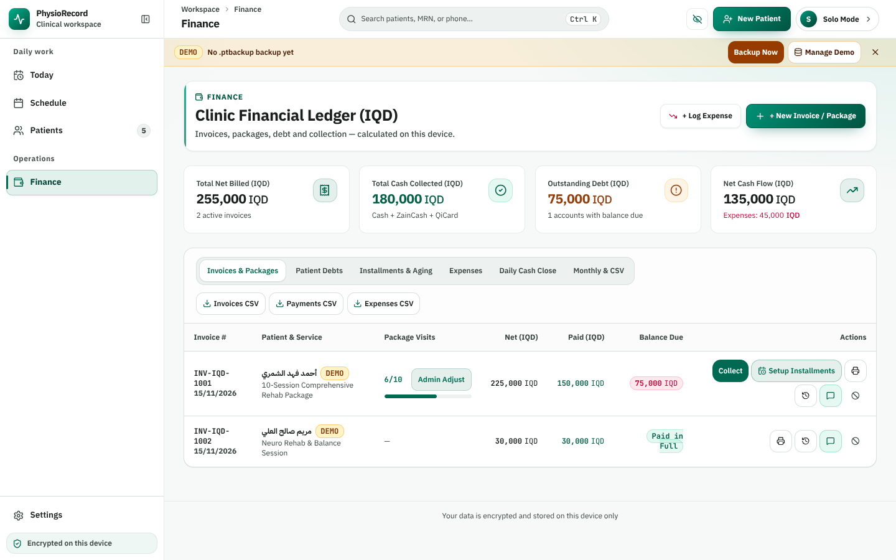

<div align="center">


# PhysioRecord

**نظام السجلات الصحية الإلكترونية (EHR) وإدارة عيادات العلاج الطبيعي — محلي بالكامل ومشفّر بمعيار AES-256-GCM**

[English](../README.md) · [**العربية**](README.ar.md) · [بوابة التوثيق](INDEX.md)

<p>
  <a href="https://github.com/Hhi5/physiorecord/actions/workflows/ci.yml">
    
  </a>
  <a href="../LICENSE">
    
  </a>
  
  
  
  
  
</p>

[نظرة عامة](#نظرة-عامة) · [معاينة الواجهات](#معاينة-الواجهات) · [الميزات الأساسية](#الميزات-الأساسية) · [الأمان والتشفير](#الأمان-والبنية-المحلية) · [التشغيل السريع](#التشغيل-السريع) · [بناء المنصات](#بناء-النسخ-المتعددة) · [بوابة التوثيق](#بوابة-التوثيق)

</div>

---

<div dir="rtl">

## نظرة عامة

**PhysioRecord** (`v1.1.0`) نظام مفتوح المصدر لإدارة السجلات السريرية وعمليات عيادات العلاج الطبيعي، مبني وفق مبدأ **البيانات محلياً أولاً (Local-First)** ودون أي خادم سحابي. تبقى جميع ملفات المرضى والتقييمات والمواعيد والحسابات مشفّرة على جهاز العيادة نفسه، ويعمل النظام كتطبيق ويب متقدم (**PWA**)، وتطبيق أندرويد (**Universal APK**)، وتطبيق سطح مكتب لويندوز (**Windows EXE**) مع دعم أصلي للغات **العربية (`RTL`)** و**الكردية السورانية (`ckb RTL`)** و**الإنجليزية (`LTR`)**.

### لماذا PhysioRecord؟

- **سيادة كاملة على بيانات المرضى:** لا توجد خوادم خارجية أو حسابات سحابية أو تتبع، مع حظر كامل لأي اتصالات شبكة خارجية وفق سياسة `Same-Origin CSP` المُختبرة آلياً.
- **حماية من انقطاع الكهرباء:** حفظ تلقائي مشفّر للمسودات داخل المتصفح (`Dexie v10 drafts`) كل ثانيتين وعند إغلاق الشاشة، مع استعادة فورية للعمل غير المحفوظ عند فتح التطبيق مجدداً.
- **توثيق سريري مخصص للعلاج الطبيعي:** مخطط جسم تفاعلي أمامي وخلفي، قياس المدى الحركي (`ROM`) والقوة العضلية (`MMT`)، بطاريات الفحوصات الخاصة، الجداول العصبية (`ASIA`)، حاسبات المقاييس مع تتبع `MCID/MDC`، وتثبيت ملاحظات `SOAP` بختم `SHA-256` غير قابل للتلاعب.
- **مُهيأ لعمل العيادات في العراق:** يدعم وضع المعالج المنفرد ووضع الفريق بصلاحيات محددة (`RBAC` و`Admin PIN`)، المواعيد المتكررة، عناوين زيارات المنازل العراقية، الفوترة الافتراضية الفارغة بالدينار العراقي (`25,000 د.ع`)، طرق الدفع المحلية (`نقداً`، `ZainCash`، `QiCard`، `أخرى`)، الأقساط وتقادم الديون، والطباعة الجاهزة `A4` و`A6`.

---

## معاينة الواجهات

</div>

<table>
  <tr>
    <td align="center" width="50%">
      
      <br />
      <sub><b>الحاسوب — مركز قيادة اليوم (العربية RTL)</b></sub>
    </td>
    <td align="center" width="50%">
      
      <br />
      <sub><b>الحاسوب — السجل المالي والباقات (الإنجليزية LTR)</b></sub>
    </td>
  </tr>
</table>

<div dir="rtl">

<details>
<summary><strong>عرض المزيد من اللقطات (الوضع الداكن وواجهة الهاتف)</strong></summary>
<br />
<table>
  <tr>
    <td align="center" width="50%">
      
      <br />
      <sub><b>الحاسوب — الوضع الداكن (العربية RTL)</b></sub>
    </td>
    <td align="center" width="25%">
      
      <br />
      <sub><b>الهاتف — قائمة اليوم</b></sub>
    </td>
    <td align="center" width="25%">
      
      <br />
      <sub><b>الهاتف — سجل المرضى</b></sub>
    </td>
  </tr>
</table>
</details>

---

## الميزات الأساسية

### 1. التوثيق السريري المتخصص للعلاج الطبيعي
- **مخطط الجسم التفاعلي واستوديو القياس:** رسوم تشريحية أمامية وخلفية مع تثبيت نقاط الألم، تخصيص نوع الألم واللون لكل نقطة، وأداة قياس زوايا الجسم وخط الشاقول على الصور (`Konva`).
- **التقييم العضلي الحركي والعصبي:** تسجيل المدى الحركي (`AROM / PROM / AAROM`) دون إظهار نطاقات معيارية مشتتة، اختبار القوة العضلية (`MMT`) بنظام حر أو مساعد، بطاريات الفحوصات الاستفزازية لتسع مناطق مفصلية، جداول `ASIA/ISNCSCI` العصبية، قوائم الفحص التحذيرية (`Red Flags`)، والمؤشرات الحيوية (`BP`, `HR`, `SpO2`).
- **مقاييس النتائج والأهداف:** حاسبات الدرجات (`ODI`, `NDI`, `QuickDASH`, `SPADI`, `LEFS`) مع حساب `MCID/MDC`، اختبارات وظيفية (`NPRS`, `PSFS`, `TUG`, `30s-CST`, `5xSTS`)، منشئ المقاييس المخصصة، قائمة المشاكل السريرية، وأهداف `SMART / GAS`.
- **توثيق `SOAP` وجدول التمارين:** ملاحظات سريرية سريعة باختصارات `/`، قوالب فحص إقليمية بضغطة واحدة، تتبع تقدم التمارين، تثبيت نهائي بختم `SHA-256`، وتعديلات حصرية عبر الملاحق السريرية (`Append-Only Clinical Addenda`).

### 2. إدارة العيادة والعمليات المالية العراقية
- **وضع العمل الفردي ووضع الفريق:** تبديل سلس بين الوضع الفردي السريع (تسجيل مراجع مفاجئ خلال 10 ثوانٍ) ووضع الفريق (مركز الاستقبال، صلاحيات الموظفين، رمز المدير `Admin PIN`، وزر تمويه الأسماء).
- **الجدولة وزيارات المنازل:** مواعيد يومية وسلاسل أسبوعية متكررة مع تنبيهات تضارب مرنة، دعم زيارات المنازل العراقية (الحي / المحلة / الزقاق / أقرب نقطة دالة مع وقت التنقل وأجرته)، إدارة الفروع، أيام الإغلاق، ووضع كشك المريض في صالة الانتظار.
- **الفوترة، الأقساط ومتابعة المراجعين:** نماذج فواتير بأرقام فارغة افتراضياً (`فحص`، `جلسة مفردة`، `كورس`)، طرق الدفع المحلية (`نقداً`، `ZainCash`، `QiCard`، `أخرى`)، خطط الأقساط وتقادم الديون (`30/60/90+` يوم)، المصاريف المتكررة، إغلاق الصندوق اليومي (`Z-Report`)، رسائل الطبيب المحيل، وقوائم استبقاء المرضى.

### 3. الطباعة، المزامنة بين أجهزة العيادة والنسخ الاحتياطي
- **بوابة الطباعة (`A4` / `A6`) وملخص إتمام العلاج:** ملاءمة تلقائية لصفحة واحدة لتقارير التقدم، ملخص المسيرة العلاجية وإتمام العلاج (مع قسم أرشفة المرضى المكتملين)، كتب الطبيب المحيل، الوصولات، الفواتير، البطاقات المختصرة، وملف المريض الكامل.
- **مزامنة متعددة الأجهزة للعيادة (اختيارية ومجانية بدون حذف):** اختر بين **مزامنة الواي فاي المحلي** عبر نفس راوتر العيادة (بدون نقطة اتصال أو إنترنت) أو **مزامنة Google Drive المشفّرة طرفياً (`AES-256-GCM`)** مجاناً مع حفظ تلقائي أوفلاين ودمج تجميعي لا يحذف أي سجل من أجهزة المعالجين.
- **النسخ الاحتياطي والمعايير الطبية:** ملفات `.ptbackup` `V3.0` (ضغط `gzip` وتشفير مجزأ `AES-GCM` مع توافق عكسي للإصدارات `V1.1`/`V2.0`)، تصدير `HL7 FHIR R4 Bundle`، استيراد المرضى من `CSV`/`XLSX` مع التراجع الفوري، وتصدير المواعيد `.ics` الخالي من البيانات السريرية الحساسة.

---

## الأمان والبنية المحلية

</div>

<div dir="ltr">

```text
Clinician Password / WebAuthn PRF
   └─▶ PBKDF2-HMAC-SHA256 (>= 600,000 iterations in Web Worker)
         └─▶ Master Key (non-extractable WebCrypto)
               ├─▶ HKDF-SHA256 Per-Record Subkeys
               └─▶ AES-256-GCM Encrypted IndexedDB (PhysioRecordDB, Dexie v1–v10)
```

</div>

<div dir="rtl">

| آلية الحماية | التفاصيل التقنية |
| --- | --- |
| **التشفير في وضع السكون** | `WebCrypto AES-256-GCM` مع حجز ذري لمتجهات التهيئة (`IV`) وتدوير تلقائي لمفاتيح التشفير عند 70% ([`src/crypto/vault.ts`](../src/crypto/vault.ts)) |
| **اشتقاق المفاتيح والدخول** | `PBKDF2-HMAC-SHA256` (أكثر من `600,000` تكرار داخل Web Worker) مع دعم اختياري للفتح بالبصمة عبر `WebAuthn PRF` |
| **الاسترداد والقفل التلقائي** | مفتاح استرداد طارئ مكوّن من `32` خانة (`8×4` Base32) + مؤقت قفل تلقائي قابل للتخصيص مع خيار «أبداً» |
| **التدقيق وعدم التعديل** | سجل تدقيق متسلسل بختم `SHA-256`، ومنع تعديل أو حذف ملاحظات `SOAP` المثبّتة نهائياً |
| **العزل التام عن الشبكة** | خطوط مستضافة محلياً (`@fontsource/*`)، مشغّل خدمة محلي (`PWA`)، وسياسة `CSP` صارمة مُختبرة تلقائياً |

> تحترم دوال الخزينة التشفيرية إسناد رخصة `GPL-3.0` لمشروع [`Niema-Lab/PhysioMeter`](https://github.com/Niema-Lab/PhysioMeter) — راجع [`NOTICE`](../NOTICE).

---

## التشغيل السريع

### المتطلبات الأساسية

- **Node.js `>= 20`** (تعمل بيئة التكامل المستمر على Node `22`) وأداة **`npm`**
- *(اختياري لبناء نسخة أندرويد APK)* **Java 21 JDK (`keytool`)** مع **Android SDK**

### التشغيل المحلي للتطوير

</div>

<div dir="ltr">

```bash
# 1. استنساخ المستودع / Clone the repository
git clone https://github.com/Hhi5/physiorecord.git
cd physiorecord

# 2. تثبيت الاعتماديات / Install dependencies
npm ci

# 3. تشغيل خادم التطوير / Start local server on http://localhost:3000
npm run dev
```

</div>

<div dir="rtl">

### وضع العرض التجريبي العام

أضف `?demo=1` إلى نهاية الرابط (مثل `http://localhost:3000/?demo=1`) أو ابنِ المشروع بالمتغير `VITE_PUBLIC_DEMO=true` لإظهار شريط التجربة الذي يتيح إضافة أو مسح 8 حالات عراقية افتراضية (`CC0-1.0` من `src/data/syntheticPatients.ts`) بضغطة واحدة.

---

## بناء النسخ المتعددة

يستخدم المشروع المعرّف الثابت `org.physiorecord.app` عبر جميع المنصات لضمان بقاء البيانات عند التحديث:

</div>

<div dir="ltr">

```bash
# 1. بناء حزمة الويب PWA / Web PWA production bundle (/sw.js & /manifest.webmanifest)
npm run build:web

# 2. تجهيز نسخة أندرويد الشاملة / Android Universal APK (Capacitor 8)
npm run android:keystore:init   # إنشاء مفتاح التوقيع لمرة واحدة (.keystore/)
npm run android:sync            # بناء حزمة أندرويد ومزامنة مشروع Gradle

# 3. نسخة سطح المكتب لويندوز / Windows Desktop (Electron 34 + electron-builder)
npm install --no-save electron@34.3.0 electron-builder@25.1.8
npm run electron:start          # تشغيل نافذة سطح المكتب محلياً
npm run electron:dist           # إنتاج حزمة التثبيت NSIS والنسخة المحمولة Portable .exe

# 4. توحيد رقم الإصدار عبر جميع الملفات / Sync version metadata
node scripts/sync-version.mjs --version=v1.1.0
```

</div>

<div dir="rtl">

راجع [`docs/DESKTOP_ANDROID_RELEASE.md`](DESKTOP_ANDROID_RELEASE.md) و[`docs/UPDATES_AND_SIGNING.md`](UPDATES_AND_SIGNING.md) لتفاصيل مفاتيح التوقيع واختبار بقاء البيانات أثناء الترقية.

---

## التقنيات وهيكلة المشروع

| الطبقة | التقنيات المعتمدة |
| --- | --- |
| **الواجهة وإمكانية الوصول** | React `19`، TypeScript `7`، Tailwind CSS v4، مكوّنات React Aria (`Apache-2.0`)، أيقونات Lucide (`ISC`) |
| **الخطوط المحلية** | `@fontsource/ibm-plex-sans-arabic`، `@fontsource/inter`، `@fontsource/jetbrains-mono` (`OFL-1.1`) |
| **قاعدة البيانات والبحث** | Dexie `4` (`IndexedDB` `v1`–`v10`، 28 جدولاً)، `MiniSearch` `7` (بحث عربي وكردي مُطبّع)، `Zod` `4` |
| **الرسم والقياس السريري** | `Konva` + `react-konva` (استوديو قياس الزوايا والصور السريرية) |
| **منصات الهاتف وسطح المكتب** | Capacitor `8` (`@capacitor/android`)، Electron `34` + `electron-builder` (`25.1.8`) |
| **البناء والاختبارات** | Vite `8`، Vitest `5`، Playwright `1.65` + `@axe-core/playwright` |

<details>
<summary><strong>استعراض هيكل مجلدات المشروع</strong></summary>

</div>

<div dir="ltr">

```text
physiorecord/
├── .github/                  # مهام CI والإصدارات، القوالب، وملفات SECURITY وCONTRIBUTING
├── android/                  # مشروع أندرويد Capacitor (Universal APK)
├── docs/                     # بوابة التوثيق (INDEX.md)، README.ar.md، ومجلد legal/
├── e2e/                      # اختبارات Playwright الشاملة وإعدادات playwright.config.ts
├── electron/                 # غلاف Electron وإعدادات التغليف electron-builder.yml
├── public/                   # الأيقونات الثابتة وترويسات الأمان (_headers)
├── scripts/                  # سكربتات البناء، PWA، فحص التراخيص والأداء، وSBOM
├── src/
│   ├── components/
│   │   ├── clinic/           # اليوم، الاستقبال، المواعيد، المالية، التمارين، النوافذ
│   │   ├── layout/           # الهيكل العام والشريط الجانبي والتنقل
│   │   ├── organui/          # الرسوم البيانية لتطور الحالة وجدول الأدوية
│   │   ├── print/            # بوابة الطباعة A4/A6 (تقارير، فواتير، بطاقات، موافقات)
│   │   ├── settings/         # تبويبات الإعدادات وتخصيص الخطوط والمظهر
│   │   ├── toolkit/          # مرجع جدول الفحص الحسي ASIA/ISNCSCI
│   │   ├── ui/               # المكوّنات الأساسية المتوافقة مع إمكانية الوصول
│   │   ├── widgets/          # مخطط الجسم، المدى الحركي، العضلات، الأعصاب، المقاييس
│   │   └── workspace/        # ملف المريض الشامل (chart/) وشاشة الجلسة (session/)
│   ├── context/              # إدارة الخزينة، اللغات (ar/ckb/en)، المظهر، العملة، الجلسات
│   ├── crypto/               # التشفير AES-GCM، عامل PBKDF2، النسخ الاحتياطي، البصمة
│   ├── data/                 # قوالب الموافقات، الاختصارات CC0، المصطلحات، الكتالوجات
│   ├── db/                   # مخطط Dexie v1–v10 (28 جدولاً) ومساعدات المتانة
│   ├── hooks/                # خطافات واجهة الاستخدام القابلة لإعادة الاستخدام
│   ├── i18n/                 # ملفات الترجمة العربية والإنجليزية والكردية السورانية
│   ├── platform/             # الجسر الموحد للويب والأندرويد وسطح المكتب
│   ├── pwa/                  # تسجيل مشغّل الخدمة المحلي وإدارة التحديثات
│   ├── services/             # طبقة الكتابة الموحدة للعمليات السريرية والمالية
│   ├── styles/themes/        # لوحات الألوان الدلالية في Tailwind v4
│   ├── types/                # تعريفات TypeScript السريرية والتشغيلية
│   └── utils/                # حسابات MCID/MDC، تصدير FHIR R4، استيراد CSV/XLSX
├── AGENTS.md                 # الثوابت الهندسية وتخصيصات العيادات العراقية وقواعد التراخيص
├── CHANGELOG.md              # سجل التحديثات الكامل
├── LICENSE                   # رخصة GPL-3.0-or-later
└── NOTICE                    # إشعارات الإسناد للمكتبات والمصادر المفتوحة
```

</div>

<div dir="rtl">

</details>

---

## التحقق والامتثال

تخضع كل مساهمة لسلسلة من بوابات التحقق التلقائية الخاصة بالأمان، التراخيص، الميزانية البرمجية، والعزل الشبكي:

</div>

<div dir="ltr">

```bash
npm run check:licenses                    # التحقق من تراخيص الحزم البرمجية (SPDX)
npm run check:content                     # التحقق من توثيق الرسومات والبيانات في docs/legal/CONTENT_LICENSES.md
npm run lint                              # الفحص الساكن لأنواع TypeScript
npm test                                  # اختبارات الوحدة والتشفير والترقيات عبر Vitest
npm run build                             # بناء نسخة الإنتاج والتحقق من PWA وCSP
npm run check:perf                        # فحص أحجام الحزم مقابل ميزانية الأداء
npm run sbom                              # توليد ملف build/sbom.cdx.json
npm run test:e2e                          # اختبارات Playwright الشاملة والعزل الشبكي وRTL
npm audit --omit=dev --audit-level=high   # فحص ثغرات اعتماديات الإنتاج
```

</div>

<div dir="rtl">

---

## بوابة التوثيق

| الدليل | المحتوى |
| --- | --- |
| **[`docs/INDEX.md`](INDEX.md)** | الفهرس الشامل لجميع الوثائق التقنية والسريرية |
| **[`CHANGELOG.md`](../CHANGELOG.md)** | سجل التحديثات الكامل (`v1.0.0` و`v1.1.0`) |
| **[`docs/ARCHITECTURE.md`](ARCHITECTURE.md)** | البنية المحلية، خدمات الكتابة الموحدة وتوزيع جداول Dexie |
| **[`docs/THREAT_MODEL.md`](THREAT_MODEL.md)** | نموذج التهديدات الأمنية وتصميم التشفير المحلي |
| **[`docs/MIGRATIONS.md`](MIGRATIONS.md)** | دليل ترقيات قاعدة البيانات التسلسلي (`v1`–`v10`) |
| **[`docs/BACKUP_FORMAT.md`](BACKUP_FORMAT.md)** | المواصفة التشفيرية لملف `.ptbackup` `V3.0` |
| **[`docs/FHIR_R4_MAPPING.md`](FHIR_R4_MAPPING.md)** | ربط السجلات السريرية بمعيار `HL7 FHIR R4` |
| **[`docs/TRANSLATION_GUIDE.md`](TRANSLATION_GUIDE.md)** | دليل تعريب اللغات (`ar` / `ckb` / `en`) وقواعد `RTL` |
| **[`docs/UI_DESIGN_SYSTEM_V2.md`](UI_DESIGN_SYSTEM_V2.md)** | نظام التصميم الحديث والرموز التصميمية `pr-*` |

---

## إخلاء المسؤولية الطبية والترخيص

> **تنبيه سريري مهم:** برنامج **PhysioRecord** أداة محلية لتنظيم السجلات السريرية وإدارة العيادة وليس جهازاً طبياً معتمداً. بعض الكتالوجات السريرية المدمجة موسومة بـ *"Pending Clinician Review"* وتستوجب مراجعة المعالج المختص قبل الاعتماد عليها. راجع [`DISCLAIMER.md`](legal/DISCLAIMER.md) و[`PRIVACY.md`](legal/PRIVACY.md) و[`SECURITY.md`](../.github/SECURITY.md).

- **المساهمة:** يُرجى قراءة [`AGENTS.md`](../AGENTS.md) و[`CONTRIBUTING.md`](../.github/CONTRIBUTING.md) و[`CODE_OF_CONDUCT.md`](../.github/CODE_OF_CONDUCT.md) قبل تعديل مخطط قاعدة البيانات أو التشفير أو الإعدادات العراقية الافتراضية أو إضافة حزم جديدة.
- **الترخيص:** المشروع مرخّص بموجب **`GPL-3.0-or-later`** — راجع [`LICENSE`](../LICENSE) و[`NOTICE`](../NOTICE) و[`CONTENT_LICENSES.md`](legal/CONTENT_LICENSES.md) و[`THIRD_PARTY_NOTICES.md`](legal/THIRD_PARTY_NOTICES.md).

</div>
