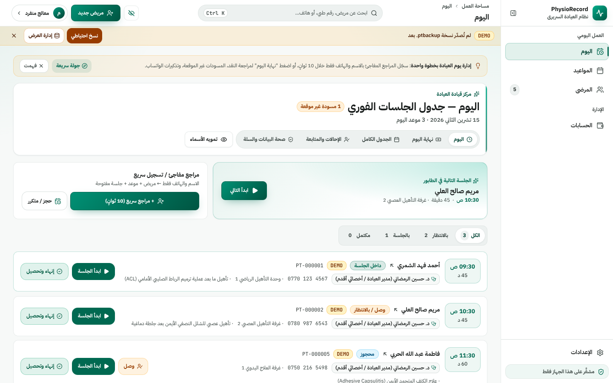
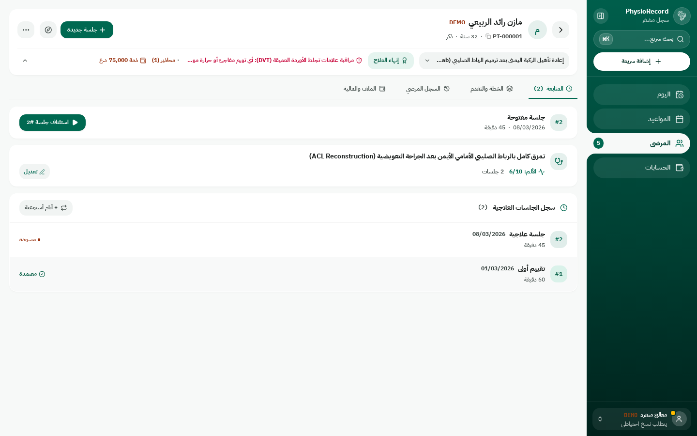
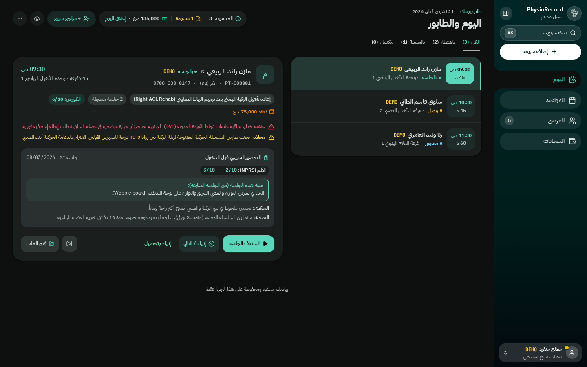
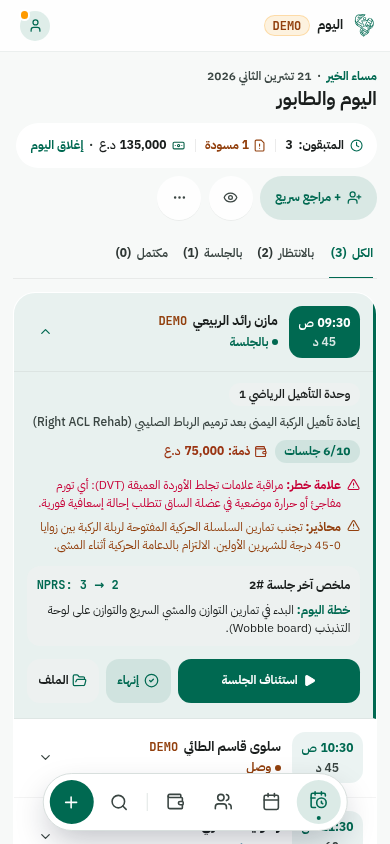
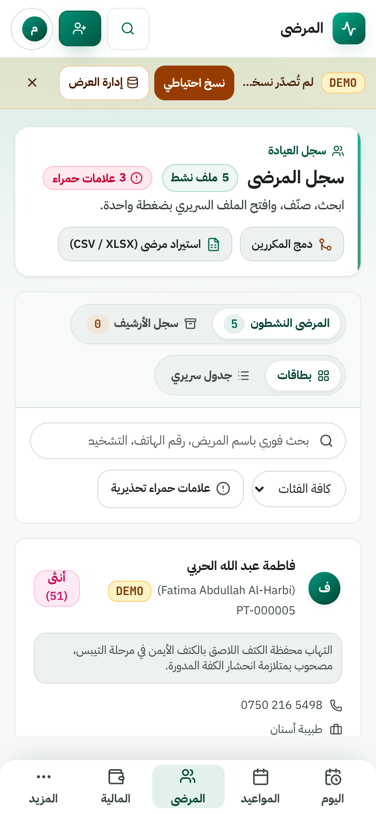
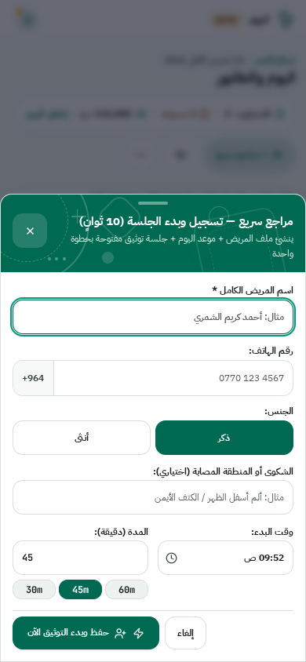

<div align="center">


# PhysioRecord

**نظام السجلات الصحية الإلكترونية (EHR) وإدارة عيادات العلاج الطبيعي — محلي بالكامل، بدون خادم، ومشفّر بمعيار AES-256-GCM**

[English](../README.md) · [**العربية**](README.ar.md) · [بوابة التوثيق](INDEX.md) · [أحدث إصدار](https://github.com/Hhi5/physiorecord/releases/latest)

<p>
  <a href="https://github.com/Hhi5/physiorecord/actions/workflows/ci.yml">
    
  </a>
  <a href="../LICENSE">
    
  </a>
  
  
  
  
  
  
</p>

[نظرة عامة](#نظرة-عامة) · [التثبيت والمنصات](#التثبيت-والمنصات-المدعومة) · [معاينة الواجهات](#معاينة-الواجهات) · [سرد الميزات الكامل](#سرد-الميزات-الكامل) · [المزامنة المجانية](#إعداد-المزامنة-متعددة-الأجهزة-اختيارية-ومجانية) · [الأمان والتشفير](#الأمان-وبنية-الثقة) · [دليل المطورين](#دليل-التشغيل-للمطورين) · [التوثيق](#بوابة-التوثيق)

</div>

---

<div dir="rtl">

## نظرة عامة

**PhysioRecord** (`v1.1.0`) نظام مفتوح المصدر لإدارة السجلات السريرية (EHR) وعمليات عيادات العلاج الطبيعي والتأهيل، مصمّم خصيصاً للمعالجين المنفردين وعيادات العلاج الطبيعي متعددة المعالجين.

تبقى جميع ملفات المرضى والتقييمات والصور السريرية والمواعيد والفواتير **مشفّرة على جهاز العيادة نفسه** (`IndexedDB` + `WebCrypto AES-256-GCM`) — **بدون حسابات إلزامية، بدون اشتراكات شهرية، بدون خادم مركزي، وبدون أي تتبع**. يدعم النظام بشكل أصلي اللغات **العربية (`ar RTL`)** و**الكردية السورانية (`ckb RTL`)** و**الإنجليزية (`en LTR`)**، مع خيار مزامنة مجانية (`$0`) عبر **الواي فاي المحلي للعيادة** أو **Google Drive المشفّر طرفياً**.

### لمحة سريعة

| الركيزة | ما يقدّمه النظام لك |
| --- | --- |
| **سيادة محلية 100%** | يعمل أوفلاين بالكامل منذ اللحظة الأولى. بدون خوادم خاصة بالمنصة، بدون تتبع، وسياسة عزل شبكي `Same-Origin CSP` مُختبَرة آلياً بـ Playwright. |
| **خزينة مشفّرة طرفياً** | تشفير `WebCrypto AES-256-GCM` مع `PBKDF2-HMAC-SHA256` (أكثر من `600,000` دورة في Web Worker)، ومفاتيح فرعية `HKDF-SHA256` لكل سجل، ومفتاح استرداد طارئ، ودعم البصمة وقفل النظام. |
| **مقاوم لانقطاع الكهرباء** | حفظ تلقائي مشفّر للمسودات داخل `IndexedDB` كل ثانيتين وعند إغلاق الصفحة لضمان عدم ضياع أي ملاحظة سريرية أو فاتورة. |
| **مصمّم للعلاج الطبيعي فعلياً** | مخطط جسم أمامي وخلفي، `ROM` ثنائي، `MMT`، فحوصات خاصة لـ 9 مفاصل، فحص عصبي `ISNCSCI / ASIA`، حاسبات مقاييس النتائج مع `MCID/MDC`، استوديو قياس زوايا الصور، وتثبيت ملاحظات `SOAP` بختم `SHA-256`. |
| **مُهيّأ للعيادات في العراق** | وضع فردي ووضع فريق (`RBAC`)، مواعيد متكررة، عناوين زيارات المنازل العراقية، فوترة بالدينار العراقي (`25,000 د.ع`) والعملات العالمية، دفع محلي (`نقداً`، `ZainCash`، `QiCard`، `أخرى`)، أقساط، وطباعة `A4`/`A6`. |
| **مزامنة اختيارية ومجانية (`$0`)** | معطّلة افتراضياً؛ يمكنك تفعيل **الواي فاي المحلي (LAN)** أو **Google Drive المشفّر** أو ملفات **`.ptsync.json`** مع دمج آمن لا يحذف السجلات تلقائياً ويدعم مزامنة عمليات الحذف الصريحة عبر شواهد حذف مشفّرة (`deletionTombstones`). |

---

## التثبيت والمنصات المدعومة

يستخدم النظام معرّفاً ثابتاً موحداً (`org.physiorecord.app`) لضمان بقاء الخزينة المشفّرة عند كل تحديث:

| المنصة | طريقة التثبيت الموصى بها | حفظ البيانات والتحديثات |
| --- | --- | --- |
| **ويندوز 10 / 11 (x64)** | حمّل ملف **`PhysioRecord-Setup-*.exe`** (أو النسخة المحمولة Portable) من [صفحة الإصدارات على GitHub](https://github.com/Hhi5/physiorecord/releases/latest). | تطبيق سطح مكتب مستقل (Electron عبر `app://bundle`). تثبيت النسخة الأحدث يرقّي التطبيق مباشرة مع الحفاظ الكامل على البيانات داخل `%APPDATA%\PhysioRecord`. |
| **أندرويد (هاتف وتابلت)** | حمّل ملف **`PhysioRecord-*.apk`** الموقّع من [صفحة الإصدارات على GitHub](https://github.com/Hhi5/physiorecord/releases/latest). | تطبيق أندرويد أصيل (`org.physiorecord.app`) يدعم الترقية الموضعية والفتح ببصمة الجهاز. |
| **آيفون وآيباد (iOS / iPadOS)** | افتح رابط التطبيق في متصفح **Safari** ← اضغط **مشاركة (Share)** ← **إضافة إلى الشاشة الرئيسية (Add to Home Screen)**. | يعمل كتطبيق مستقل أوفلاين بالكامل من الشاشة الرئيسية ببيانات مشفّرة محلياً — دون الحاجة لاشتراك App Store. |
| **ماك (macOS)** | افتحه في **Safari** ← **File ← Add to Dock** (أو عبر Chrome/Edge ← **Install App**). | يعمل كتطبيق مستقل في الـ Dock مع تخزين محلي مشفّر دائم. |

> **بوابة توجيه المنصات الذكية:** على النسخة المستضافة في الويب، يتم توجيه مستخدمي متصفح أندرويد وويندوز تلقائياً لتحميل النسخة المثبّتة، وتوجيه مستخدمي آيفون وماك لتثبيت التطبيق على الشاشة الرئيسية أو الـ Dock لضمان عدم فقدان البيانات في تبويب متصفح مؤقت.

---

## معاينة الواجهات

</div>

<table>
  <tr>
    <td align="center" width="50%">
      
      <br />
      <sub><b>الحاسوب — مركز قيادة اليوم (العربية RTL)</b></sub>
    </td>
    <td align="center" width="50%">
      
      <br />
      <sub><b>الحاسوب — الصندوق والحسابات المالية (الإنجليزية LTR)</b></sub>
    </td>
  </tr>
</table>

<div dir="rtl">

<details>
<summary><strong>عرض المزيد من اللقطات (ملف المريض، الوضع الداكن، وواجهة الهاتف)</strong></summary>
<br />
<table>
  <tr>
    <td align="center" width="50%">
      
      <br />
      <sub><b>الحاسوب — ملف المريض السريري (العربية RTL)</b></sub>
    </td>
    <td align="center" width="50%">
      
      <br />
      <sub><b>الحاسوب — الوضع الداكن (العربية RTL)</b></sub>
    </td>
  </tr>
</table>
<table>
  <tr>
    <td align="center" width="33%">
      
      <br />
      <sub><b>الهاتف — قائمة اليوم</b></sub>
    </td>
    <td align="center" width="33%">
      
      <br />
      <sub><b>الهاتف — سجل المرضى</b></sub>
    </td>
    <td align="center" width="33%">
      
      <br />
      <sub><b>الهاتف — تسجيل مراجع سريع</b></sub>
    </td>
  </tr>
</table>
</details>

---

## سرد الميزات الكامل

### 1. التوثيق السريري المتخصص للعلاج الطبيعي
- **ملف المريض الشامل وحلقات الرعاية:** سجل مركزي مع بحث فوري مُطبّع للعربية والكردية والإنجليزية (`MiniSearch`)، كشف التكرار ودمج الملفات بأمان مع لقطة استرجاع، الاحتياطات وموانع العلاج، متابعة تقارير الأشعة، وتسلسل حلقات العلاج.
- **مخطط الجسم التفاعلي (Body Chart):** رسوم تشريحية أمامية وخلفية لتثبيت نقاط الألم وتخصيص نوع الألم والألوان لكل نقطة.
- **بطاريات التقييم العضلي والعصبي:**
  - **المدى الحركي (`ROM`):** تسجيل ثنائي (يمين/يسار) للـ `AROM / PROM / AAROM` بحقول رقمية واضحة دون نطاقات معيارية مشتتة.
  - **القوة العضلية (`MMT`):** بطاقات إدخال حر أو مساعد (`0–5`) تبدأ ببطاقة واحدة نظيفة مع زر `+` لإضافة فحوصات إضافية.
  - **الفحوصات الخاصة (Special Tests):** قائمة موجزة بالفحوصات الاستفزازية والبُنى التشريحية المستهدفة لجميع المناطق المفصلية الـ 9.
  - **الفحص العصبي الشامل (`ISNCSCI / ASIA`):** 10 عضلات مفتاحية، 28 مستوى حسياً، المنعكسات الوترية (`DTR`)، وملخص تصنيف `AIS` تلقائي.
  - **العلامات التحذيرية والمؤشرات الحيوية:** قوائم `Red Flags` حسب المنطقة ومراقبة `BP` و`HR` و`SpO2` مع تنبيهات قابلة للتخصيص.
- **مقاييس النتائج والأهداف والتطور:**
  - حاسبات درجات (`ODI`, `NDI`, `QuickDASH`, `SPADI`, `LEFS`) مع تتبع `MCID/MDC`، واختبارات وظيفية (`NPRS`, `PSFS`, `TUG`, `30s-CST`, `5xSTS`)، بالإضافة إلى **منشئ المقاييس والنماذج المخصصة**.
  - قوائم المشاكل السريرية، أهداف `SMART / GAS`، رسوم بيانية لتطور الحالة عبر الجلسات، وأرشيف المرضى الذين أتمّوا العلاج.
- **توثيق `SOAP` وجداول الجلسة:** شاشة جلسة موحدة باختصارات `/`، قوالب فحص بضغطة واحدة، جداول التمارين والعلاج اليدوي والأجهزة الفيزيائية، ختم نهائي `SHA-256` غير قابل للتلاعب، وتصحيحات حصرية عبر الملاحق السريرية (`Append-Only Addenda`).
- **خزينة المرفقات واستوديو قياس الصور:** حفظ مشفّر لصور المريض وتقارير PDF مع مقارنة جانبية، واستوديو `Konva` لقياس زوايا المفاصل وزاوية كوب والمسافات وخط الشاقول على الصور.

### 2. إدارة العيادة وجدولة المواعيد
- **الوضع الفردي ووضع الفريق (`RBAC`):** التبديل بين الوضع الفردي السريع (تسجيل مراجع خلال 10 ثوانٍ من واجهة اليوم) ووضع الفريق (مركز الاستقبال، صلاحيات الموظفين، رمز المدير `Admin PIN`، وزر تمويه الأسماء للخصوصية).
- **الجدولة والزيارات المنزلية العراقية:** مواعيد يومية وسلاسل أسبوعية متكررة مع ساعة اختيار تفاعلية وإدخال يدوي مرن لمدة الجلسة وتنبيهات تضارب غير معطّلة، ودعم كامل لـ **عناوين زيارات المنازل العراقية** (الحي / المحلة / الزقاق / أقرب نقطة دالة مع وقت وأجرة التنقل)، والفروع، وأيام الإغلاق.
- **كشك المريض ومكتبة التمارين المنزلية (`HEP`):** وضع كشك الاستقبال في صالة الانتظار، ومكتبة تمارين منزلية مدمجة (مخفية افتراضياً ويمكن إظهارها من الإعدادات).
- **الأطباء المحيلون واستبقاء المرضى:** دليل الأطباء المحيلين وإحصائيات الإيراد حسب مصدر الإحالة، وكتب متابعة رسمية جاهزة للطباعة (`A4`) للطبيب المحيل، و4 قوائم متابعة واستبقاء مع رسائل واتساب جاهزة.

### 3. النظام المالي العراقي والفوترة
- **فواتير نظيفة بدون قيم مفروضة:** تبدأ نماذج الفواتير فارغة دائماً، وتدعم أنواع الخدمات: `فحص`، `جلسة مفردة`، و`كورس`.
- **العملات وطرق الدفع العراقية:** اختيار عالمي للعملات (`ISO 4217`) يبدأ افتراضياً بالدينار العراقي (`25,000 د.ع` بالرمز بعد الرقم)، مع طرق الدفع المحلية: `نقداً`، `ZainCash`، `QiCard`، و`أخرى` بنص حر.
- **الأقساط والمصاريف وإغلاق الصندوق:** خطط أقساط متعددة، تقارير تقادم الديون (`30/60/90+` يوم)، المصاريف الدورية، وتقرير إغلاق الصندوق اليومي (`Z-Report`).

### 4. الطباعة، النسخ الاحتياطي والمعايير الطبية
- **بوابة الطباعة (`A4` / `A6`) والتصدير المباشر:** ملاءمة تلقائية لصفحة واحدة للفواتير والوصولات وتقارير الأطباء وملخص إتمام العلاج وملف المريض الكامل والموافقات الموقّعة (مع حفظ PDF مباشر في نسخة سطح المكتب).
- **النسخ الاحتياطي وتجارب الاستعادة:** ملفات `.ptbackup` `V3.0` (ضغط `gzip` وتشفير مجزأ `AES-GCM` متوافق مع الإصدارات السابقة)، مجلد نسخ احتياطي تلقائي على الحاسبة، وتجربة فحص استعادة آمنة في بيئة معزولة.
- **المعايير وجودة البيانات:** تصدير `HL7 FHIR R4 Bundle`، استيراد المرضى من `CSV`/`XLSX` مع معاينة وتراجع فوري، تصدير المواعيد `.ics` بخصوصية كاملة، سلة محذوفات 30 يوماً للسجلات غير السريرية، وفاحص سلامة البيانات.

---

## إعداد المزامنة متعددة الأجهزة (اختيارية ومجانية)

تكون المزامنة **مُعطّلة افتراضياً** ولا يجري التطبيق أي اتصال خارجي إلا بعد اختيارك وتفعيلك لأحد الخيارات من **الإعدادات ← البيانات والمزامنة**:

| وضع المزامنة | الأنسب لـ | يحتاج إنترنت؟ | هل يلزم بقاء الحاسبة مفتوحة؟ | مستوى الخصوصية |
| --- | --- | --- | --- | --- |
| **1. الواي فاي المحلي (LAN Hub)** | أجهزة متصلة بنفس راوتر العيادة | **لا (100% أوفلاين)** | فقط لحظة المزامنة (التعديلات تُحفظ وتُرسل لاحقاً عند تشغيلها) | شبكة محلية خاصة فقط (RFC1918) + رمز اقتران 64-بت + حزم `AES-256-GCM` |
| **2. Google Drive المشفّر (BYOC)** | المزامنة عند إطفاء الحاسبة أو بين الفروع أو من المنزل | فقط لحظة المزامنة (يحفظ أوفلاين تلقائياً) | **لا** | تشفير محلي `AES-256-GCM` + `PBKDF2` (`310,000` دورة) قبل الرفع؛ صلاحية `drive.file` فقط |
| **3. ملف مشفّر (`.ptsync.json`)** | النقل اليدوي عبر USB أو واتساب أو المشاركة المحلية | **لا** | **لا** | ملف مشفّر طرفياً يُدمج تجميعياً بدون حذف |

> **ضمان المزامنة الآمنة وشواهد الحذف (`deletionTombstones`):** غياب سجل في جهاز آخر **لا يحذف** السجل المحلي مطلقاً؛ بينما تُزامَن عمليات الحذف الصريحة المؤكّدة من المعالج عبر شواهد حذف مشفّرة (`Dexie v11`) لمنع عودة السجلات المحذوفة عند الدمج أو الاستعادة، مع بقاء ملاحظات `SOAP` المعتمدة محمية.

---

## الأمان وبنية الثقة

</div>

<div dir="ltr">

```text
Clinician Password / WebAuthn PRF / Windows Hello / Touch ID
   └─▶ PBKDF2-HMAC-SHA256 (>= 600,000 iterations in dedicated Web Worker)
         └─▶ Master Key (non-extractable WebCrypto)
               ├─▶ HKDF-SHA256 Per-Record Subkeys
               └─▶ AES-256-GCM Encrypted IndexedDB (PhysioRecordDB, Dexie v1–v11)
```

</div>

<div dir="rtl">

| آلية الحماية | التفاصيل التقنية |
| --- | --- |
| **التشفير في وضع السكون** | `WebCrypto AES-256-GCM` مع حجز ذري لمتجهات التهيئة (`IV`) وتدوير تلقائي لمفاتيح التشفير عند 70% ([`src/crypto/vault.ts`](../src/crypto/vault.ts)) |
| **اشتقاق المفاتيح والدخول** | `PBKDF2-HMAC-SHA256` (أكثر من `600,000` دورة في Web Worker) + دعم اختياري لـ `WebAuthn PRF`، بصمة أندرويد، Windows Hello (`DPAPI`)، وTouch ID (`Keychain`) |
| **الاسترداد والقفل التلقائي** | مفتاح استرداد طارئ مكوّن من `32` خانة (`8×4` Base32) + مؤقت قفل تلقائي قابل للتخصيص مع خيار «أبداً» |
| **التدقيق والسلامة السريرية** | سجل تدقيق متسلسل بختم `SHA-256`، وتصحيح ملاحظات `SOAP` المعتمدة حصراً عبر الملاحق (`Append-Only`) |
| **العزل الشبكي الافتراضي** | خطوط محلية (`@fontsource/*`)، رسومات وملفات محلية بالكامل، وسياسة `CSP` صارمة مُثبتة باختبارات Playwright الأوفلاين |
| **تحصين سطح المكتب والمستورد** | التحقق من أصل أوامر IPC وحدود المسارات في Electron، سياسة `connect-src 'none'`، منع SSRF في المزامنة المحلية، حماية خادم LAN من التخمين العنيف (`429`)، تنظيف XSS في التقارير المصدّرة، وحماية قارئ Excel من `Zip Bomb` |

> تحترم دوال الخزينة التشفيرية إسناد رخصة `GPL-3.0` لمشروع [`Niema-Lab/PhysioMeter`](https://github.com/Niema-Lab/PhysioMeter) — راجع [`NOTICE`](../NOTICE).

---

## دليل التشغيل للمطورين

### المتطلبات الأساسية

- **Node.js `>= 20`** (بيئة CI تعمل على Node `22`) وأداة **`npm`**
- *(اختياري لبناء أندرويد APK)* **Java 21 JDK (`keytool`)** مع **Android SDK**

### التثبيت والتشغيل المحلي

</div>

<div dir="ltr">

```bash
# 1. استنساخ المستودع / Clone the repository
git clone https://github.com/Hhi5/physiorecord.git
cd physiorecord

# 2. تثبيت الاعتماديات / Install dependencies
npm ci

# 3. (اختياري) نسخ قالب متغيرات البيئة / Copy env template
cp .env.example .env.local

# 4. تشغيل خادم التطوير / Start local server on http://localhost:3000
npm run dev
```

</div>

<div dir="rtl">

### بناء النسخ المتعددة

</div>

<div dir="ltr">

```bash
# 1. بناء حزمة الويب PWA / Web PWA production bundle
npm run build:web

# 2. تجهيز نسخة أندرويد الشاملة / Android Universal APK (Capacitor 8)
npm run android:keystore:init   # إنشاء مفتاح التوقيع لمرة واحدة (.keystore/)
npm run android:sync            # بناء حزمة أندرويد ومزامنة مشروع Gradle

# 3. نسخة سطح المكتب لويندوز / Windows Desktop (Electron 34 + electron-builder)
npm install --no-save electron@34.3.0 electron-builder@25.1.8
npm run electron:start          # تشغيل نافذة سطح المكتب محلياً
npm run electron:dist           # إنتاج NSIS Setup وPortable .exe داخل release/

# 4. توحيد رقم الإصدار عبر جميع الملفات / Sync version metadata
node scripts/sync-version.mjs --version=v1.1.0
```

</div>

<div dir="rtl">

---

## التقنيات، هيكل المجلدات وأهم القرارات المعمارية

| الطبقة | التقنيات المعتمدة |
| --- | --- |
| **الواجهة وإمكانية الوصول** | React `19`، TypeScript `7`، Tailwind CSS `4`، مكوّنات React Aria (`Apache-2.0`)، أيقونات Lucide (`ISC`) |
| **الخطوط المحلية** | `@fontsource/ibm-plex-sans-arabic`، `@fontsource/inter`، `@fontsource/jetbrains-mono` (`OFL-1.1`) |
| **قاعدة البيانات والبحث** | Dexie `4` (`IndexedDB` `v1`–`v11`، 29 جدولاً: 24 قابلاً للنقل + 5 محلية للجهاز)، `MiniSearch` `7` (بحث عربي وكردي مُطبّع)، `Zod` `4` |
| **الرسم والقياس السريري** | `Konva` `10` + `react-konva` `19` |
| **منصات الهاتف وسطح المكتب** | Capacitor `8` (`@capacitor/android`)، Electron `34` + `electron-builder` (`25.1.8`) |
| **البناء والاختبارات** | Vite `8`، Vitest `5`، Playwright `1.65` + `@axe-core/playwright` |

<details open>
<summary><strong>استعراض هيكل مجلدات المشروع</strong></summary>

<div dir="ltr">

```text
physiorecord/
├── .github/                  # مهام CI والإصدارات، القوالب، وملفات SECURITY وCONTRIBUTING
├── android/                  # مشروع أندرويد Capacitor (Universal APK)
├── docs/                     # بوابة التوثيق (INDEX.md)، README.ar.md، ومجلد legal/
├── e2e/                      # اختبارات Playwright الشاملة وإعدادات playwright.config.ts
├── electron/                 # غلاف Electron المقسّم لوحدات مستقلة
│   ├── main.mjs              # دورة حياة التطبيق، بروتوكول app://bundle، النافذة وIPC الأساسي
│   ├── preload.cjs           # جسر الربط المعزول مع الواجهة (window.physioDesktop)
│   ├── security.mjs          # سياسة CSP، التحقق من الروابط والشبكة المحلية، حفظ الإعدادات
│   ├── lanSyncServer.mjs     # خادم وعميل مزامنة الواي فاي المحلي المشفّرة
│   ├── googleOAuth.mjs       # تسجيل دخول Google OAuth PKCE وبروكسي Drive ومجلد المزامنة
│   ├── osBiometrics.mjs      # فتح الخزينة عبر Windows Hello وTouch ID باستخدام safeStorage
│   ├── githubReleases.mjs    # التحقق الاختياري من تحديثات GitHub Releases
│   └── electron-builder.yml  # إعدادات تغليف Windows NSIS وPortable
├── public/                   # الأيقونات الثابتة وترويسات الأمان (_headers)
├── scripts/                  # سكربتات البناء، PWA، فحص التراخيص والأداء، وSBOM
├── src/
│   ├── components/
│   │   ├── auth/             # شاشة القفل، غطاء الخصوصية، تذكير كلمة المرور وبوابة المنصة
│   │   ├── clinic/           # اليوم، الاستقبال، المواعيد (schedule/)، المالية، الإحالات (referrals/)
│   │   ├── layout/           # الهيكل العام، الشريط الجانبي، البحث الشامل وشريط الهاتف
│   │   ├── organui/          # الرسوم البيانية لتطور الحالة وجدول الأدوية
│   │   ├── patients/         # دليل المرضى ونوافذ المريض والحلقة والجلسة والمعاينة السريعة
│   │   ├── print/            # بوابة الطباعة A4/A6 (تقارير، فواتير، بطاقات، موافقات)
│   │   ├── settings/         # نافذة الإعدادات وتبويباتها المستقلة
│   │   ├── toolkit/          # مرجع جدول الفحص الحسي ASIA/ISNCSCI
│   │   ├── ui/               # المكوّنات الأساسية المتوافقة مع إمكانية الوصول
│   │   ├── vault/            # النسخ الاحتياطي، الترحيل، استرداد المسودات، المعالج والبيانات التجريبية
│   │   ├── widgets/          # مخطط الجسم، المدى الحركي، العضلات، الأعصاب، المقاييس
│   │   └── workspace/        # ملف المريض الشامل (chart/) وشاشة الجلسة (session/)
│   ├── config/               # الثوابت المشتركة للتطبيق (المستودع، حدود المزامنة، منفذ LAN)
│   ├── context/              # إدارة الخزينة، اللغات (ar/ckb/en)، المظهر، العملة، الجلسات
│   ├── crypto/               # التشفير AES-GCM، عامل PBKDF2، النسخ الاحتياطي، البصمة
│   ├── data/                 # قوالب الموافقات، الاختصارات CC0، المصطلحات، الكتالوجات
│   ├── db/                   # مخطط Dexie v1–v11 (29 جدولاً) ومساعدات المتانة
│   ├── hooks/                # خطافات واجهة الاستخدام القابلة لإعادة الاستخدام
│   ├── i18n/                 # ملفات الترجمة العربية والإنجليزية والكردية السورانية
│   ├── platform/             # الجسر الموحد للويب والأندرويد وسطح المكتب
│   ├── pwa/                  # مشغّل الخدمة، كشف iOS PWA وبوابة المنصات
│   ├── services/             # طبقة الكتابة الموحدة للعمليات السريرية والمالية والمزامنة
│   ├── styles/themes/        # لوحات الألوان الدلالية في Tailwind v4
│   ├── types/                # تعريفات TypeScript السريرية والتشغيلية
│   └── utils/                # حسابات MCID/MDC، تصدير FHIR R4، استيراد CSV/XLSX والأمان
├── .env.example              # توثيق متغيرات البيئة (بدون أي أسرار)
├── AGENTS.md                 # الثوابت الهندسية وتخصيصات العيادات العراقية وقواعد التراخيص
├── CHANGELOG.md              # سجل التحديثات الكامل
├── LICENSE                   # رخصة GPL-3.0-or-later
└── NOTICE                    # إشعارات الإسناد للمكتبات والمصادر المفتوحة
```

</div>

</details>

### أهم القرارات المعمارية

1. **تشفير محلي بدون خادم (`src/crypto/`, `src/db/`)**: تُشفّر جميع السجلات داخل `IndexedDB` بمفاتيح `AES-256-GCM` غير قابلة للاستخراج ومشتقة داخل Web Worker (`PBKDF2 >= 600,000` دورة) مع مفاتيح فرعية `HKDF-SHA256` وحجز ذرّي للـ `IV`.
2. **ترقيات تراكمية وثبات السجل السريري**: لا يتم تعديل إصدارات قاعدة البيانات التاريخية (`Dexie v1–v10`) أبداً؛ ويضيف `v11` جدول `deletionTombstones` مع كشف استباقي لفتح قاعدة أحدث بإصدار أقدم ومعالجة أحداث `versionchange`/`blocked` بين التبويبات. أي ملاحظة `SOAP` معتمدة تُختم بـ `SHA-256` ويتم تصحيحها عبر ملاحق إضافية (`clinicalAddenda`).
3. **طبقة كتابة موحدة (`src/services/`)**: تمر جميع عمليات القراءة والكتابة المشفّرة عبر خدمات مركزية لضمان سلامة السجل التدقيقي والمسودات وترابط البيانات.
4. **غلاف Electron محصّن ومقسّم (`electron/`)**: تعمل الواجهة تحت `app://bundle` مع حظر تام لاتصالات الشبكة (`connect-src 'none'`)، بينما تعيش العمليات الاختيارية (مزامنة LAN، OAuth، التحديثات، البصمة) في وحدات منفصلة داخل العملية الرئيسية.
5. **مزامنة اختيارية ذكية (`src/utils/clinicSyncEngine.ts`)**: لا يحذف الغياب العادي أي سجل محلي، بينما تُطبّق عمليات الحذف الصريحة المؤكّدة من المعالج عبر شواهد حذف مشفّرة (`deletionTombstones`) مع تشفير كامل قبل مغادرة الجهاز.

---

## التحقق والامتثال

</div>

<div dir="ltr">

```bash
npm run check:licenses                    # التحقق من تراخيص الحزم البرمجية (SPDX)
npm run check:content                     # التحقق من توثيق الرسومات والبيانات في docs/legal/CONTENT_LICENSES.md
npm run lint                              # الفحص الساكن لأنواع TypeScript
npm test                                  # اختبارات الوحدة والتشفير والترقيات عبر Vitest
npm run build                             # بناء نسخة الإنتاج والتحقق من PWA وCSP
npm run check:perf                        # فحص أحجام الحزم مقابل ميزانية الأداء
npm run sbom                              # توليد ملف build/sbom.cdx.json
npm run test:e2e                          # اختبارات Playwright الشاملة والعزل الشبكي وRTL
npm audit --omit=dev --audit-level=high   # فحص ثغرات اعتماديات الإنتاج
```

</div>

<div dir="rtl">

---

## بوابة التوثيق

| الدليل | المحتوى |
| --- | --- |
| **[`docs/INDEX.md`](INDEX.md)** | الفهرس الشامل لجميع الوثائق التقنية والسريرية |
| **[`CHANGELOG.md`](../CHANGELOG.md)** | سجل التحديثات الكامل (`v1.0.0` و`v1.1.0`) |
| **[`docs/ARCHITECTURE.md`](ARCHITECTURE.md)** | البنية المحلية، خدمات الكتابة الموحدة وتوزيع جداول Dexie |
| **[`docs/THREAT_MODEL.md`](THREAT_MODEL.md)** | نموذج التهديدات الأمنية وتصميم التشفير المحلي |
| **[`docs/MIGRATIONS.md`](MIGRATIONS.md)** | دليل ترقيات قاعدة البيانات التسلسلي (`v1`–`v11`) وسياسة التوافق العكسي |
| **[`docs/BACKUP_FORMAT.md`](BACKUP_FORMAT.md)** | المواصفة التشفيرية لملف `.ptbackup` `V3.0` |
| **[`docs/FHIR_R4_MAPPING.md`](FHIR_R4_MAPPING.md)** | ربط السجلات السريرية بمعيار `HL7 FHIR R4` |
| **[`docs/TRANSLATION_GUIDE.md`](TRANSLATION_GUIDE.md)** | دليل تعريب اللغات (`ar` / `ckb` / `en`) وقواعد `RTL` |
| **[`docs/UI_DESIGN_SYSTEM_V2.md`](UI_DESIGN_SYSTEM_V2.md)** | نظام التصميم الحديث والرموز التصميمية `pr-*` |

---

## إخلاء المسؤولية الطبية والترخيص

> **تنبيه سريري مهم:** برنامج **PhysioRecord** أداة محلية لتنظيم السجلات السريرية وإدارة العيادة وليس جهازاً طبياً معتمداً. بعض الكتالوجات السريرية المدمجة موسومة بـ *"Pending Clinician Review"* وتستوجب مراجعة المعالج المختص قبل الاعتماد عليها. راجع [`DISCLAIMER.md`](legal/DISCLAIMER.md) و[`PRIVACY.md`](legal/PRIVACY.md) و[`SECURITY.md`](../.github/SECURITY.md).

- **المساهمة:** يُرجى قراءة [`AGENTS.md`](../AGENTS.md) و[`CONTRIBUTING.md`](../.github/CONTRIBUTING.md) و[`CODE_OF_CONDUCT.md`](../.github/CODE_OF_CONDUCT.md) قبل تعديل مخطط قاعدة البيانات أو التشفير أو الإعدادات العراقية الافتراضية أو إضافة حزم جديدة.
- **الترخيص:** المشروع مرخّص بموجب **`GPL-3.0-or-later`** — راجع [`LICENSE`](../LICENSE) و[`NOTICE`](../NOTICE) و[`CONTENT_LICENSES.md`](legal/CONTENT_LICENSES.md) و[`THIRD_PARTY_NOTICES.md`](legal/THIRD_PARTY_NOTICES.md).

</div>
